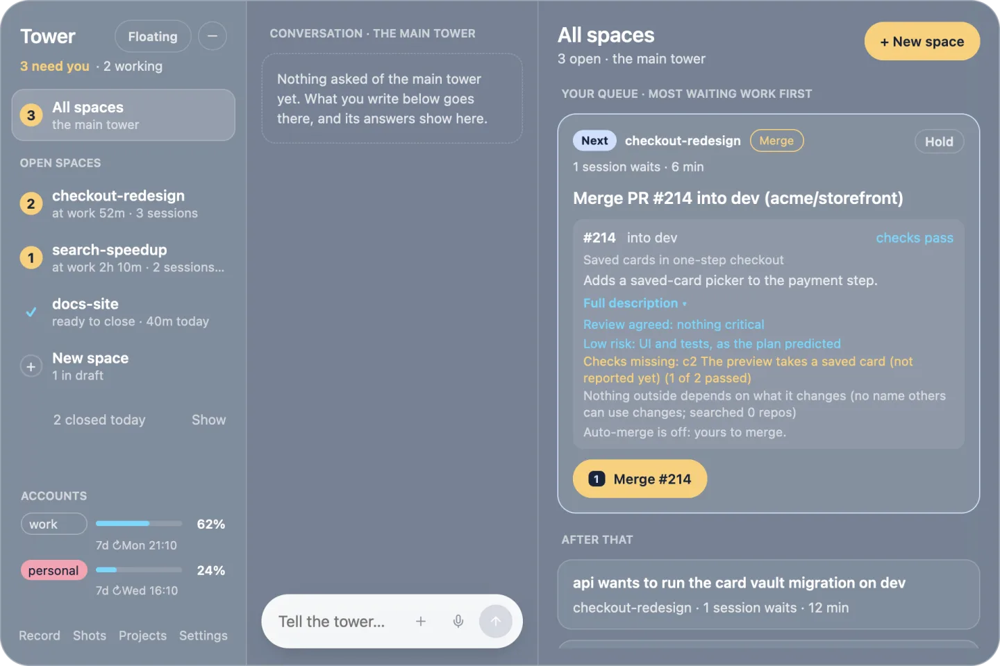
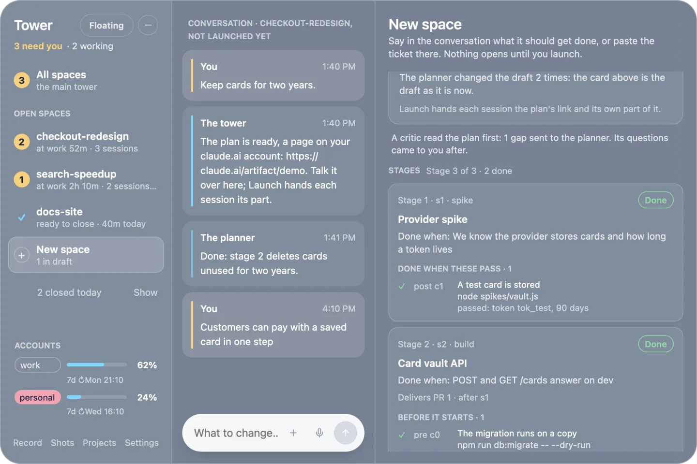
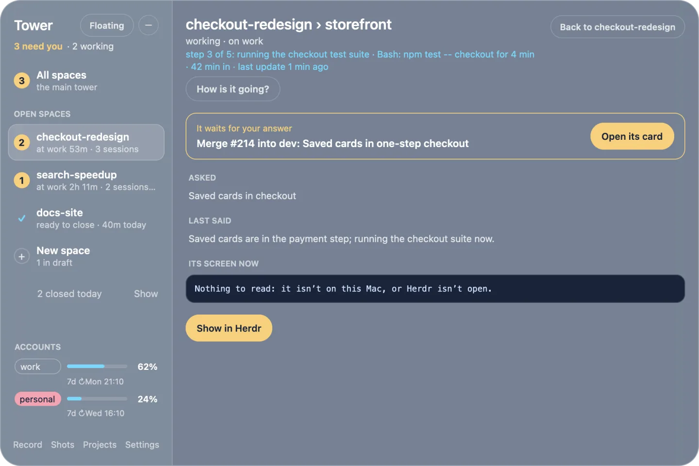
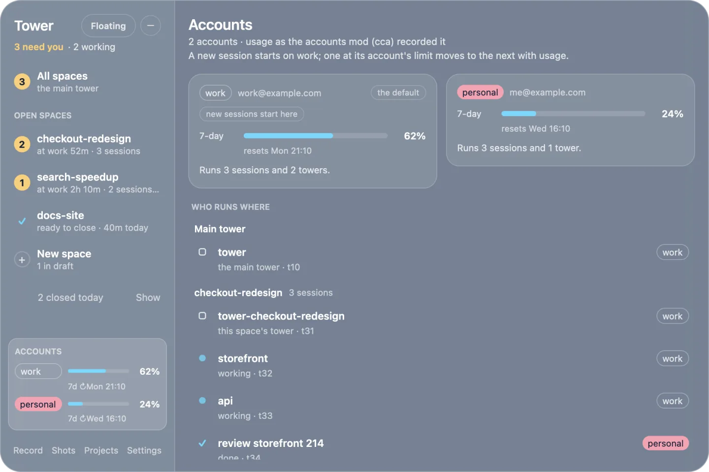

# herdr-tower

A control tower for the Claude Code and Codex sessions you run in
[Herdr](https://herdr.dev). You talk to it, on the Mac or on your phone, and
it steers them: it opens spaces for a goal, hands out the work, watches every
session on this Mac and on every machine added with `hc machine add`, answers
the routine questions itself and brings you only what is yours to decide.

<p align="center">
  
  <br><sub>One queue for every space, the heaviest first: here a merge card with its checks, review, risk score, validation and impact.</sub>
</p>

Everything that listens and speaks runs locally, in one Rust binary
(Whisper for the ears, Kokoro for the voice); the tower's brain is a Claude
Code (or Codex) session of its own. The screenshots here use made-up spaces,
sessions and accounts ([`docs/screenshots/demo_state.py`](docs/screenshots/demo_state.py)).

## What it does

### Spaces are missions

A space is a goal with an end. Say one sentence ("let customers pay with a
saved card") or paste a ticket: the tower drafts the space (its name, goal,
what counts as done, a session per repo, each in its own git worktree with
its own dev port), and nothing opens until you launch it. Each space gets a
tower of its own, a brain that follows its sessions, and the space closes
itself once its goal is met and it has been quiet.

<p align="center">
  
  <br><sub>A space's brief, kept current: its stage, what is done, what is in progress (each session's live progress line), what is next, what waits for you, the risks. Above it, how long the space has been at work.</sub>
</p>

### Decisions, not noise

The tower answers the routine 90% of what sessions ask (a file edit in a
session's own memory, a question with an obvious answer under your
behaviors) and puts the other 10% in one **decisions queue**: permissions,
questions, merges, failures, what a brain raised. Each card says who waits
and for how long, offers the answers with one recommended, and answers with
a number key, on the Mac or the phone. A card can be put on hold with your
reason; what it decides can be made a rule. How much it tells you is yours:
`tower tell decisions | results | everything`.

### Agendas: every request, until it is verified

Each request of yours becomes an **agenda** with its tasks: who got each,
when it was delivered, and whether it was verified, failed (twice: a
decision for you) or dropped. Nothing you asked for silently disappears.

### Plans before work

`Plan it first` hands a draft to the tower's planner, which reads the repos
and writes a plan as a page on your claude.ai account. **Plans v2**: the
plan has **stages** (spike, build, release), each with what counts as done
and the checks before and after it; a **critic** reads the draft first and
sends its gaps back; **spikes** run before the build and feed a revision;
and once launched the plan stays **live**: what the sessions find (an
assumption that turned out wrong, a PR that has to split) revises it,
small changes by themselves and big ones on your word.

<p align="center">
  
  <br><sub>A plan in the launcher: the conversation with the planner, the critic's note, and each stage with the checks that say it is done.</sub>
</p>

### Live progress, and asking without interrupting

Every working session has a **progress line**, read from its transcript
every 15 s: step N of M of its task list, the call at work and for how
long, time in, last update ("step 3 of 5: running the checkout test suite ·
41 min in · last update just now"). The sessions the tower starts keep a
task list (`[sessions] todo_tools`). **How is it going?** asks a working
session a side question with Claude Code's own `/btw`: it answers in an
overlay while its turn goes on, and the tower reads the answer back
(`tower progress <session> [question]`).

<p align="center">
  
  <br><sub>A session: its progress line, How is it going?, the card it waits on, what it was asked and last said.</sub>
</p>

### Background jobs and browsers

A session's turn can end while its work goes on. The tower sees Claude
Code's background shells and tells **jobs** (a training run, an eval, a
deploy wait) from **servers** (a dev server, a container) and watchers: a
session with a job shows "running a job: Train the 1.2B ranker, since 13:05,
last progress just now", not done, is flagged once if a job goes quiet, and
you hear when it ends. A finite script that starts a helper server for
itself stays a job. It also shows when a session drives a **browser**
(Claude in Chrome, the built-in one, Playwright, a headless one), which
site, since when, and warns when two sessions share your Chrome.

### Accounts, usage and failover

Each session, tower and space shows the Claude account it runs on, and each
account its usage (the accounts mod `cca`). A session or tower that hits
its account's limit is **moved**: resumed in its own terminal on the next
account with usage, with its conversation and what it was doing.

<p align="center">
  
  <br><sub>Accounts: usage and resets, where new sessions start, who runs where.</sub>
</p>

### PRs, from review to release

Every PR a space's sessions open is followed: its checks, and a **reviewer
session** that looks for critical issues and agrees with the PR's session
before you merge. A **review score** says whether it needs a human review
(a migration, a breaking change, secrets, infrastructure, auth, money…) or
is low risk; **validation** lists the planned checks with their proof;
**impact** names who outside depends on what it changes. The merge card
merges it (or a chain of PRs in order), and with `tower automerge on` the
tower merges low-risk PRs into dev itself. The **release track** shows where
each change stands, repo by repo: open, on dev, on prod.

### Voice and the orb

<p align="center">
  
</p>

Hold Control anywhere to talk (or set a wake word); it answers out loud and
in text. The orb floats on the screen: how it moves says what the tower is
doing, its number how many decisions wait; click it for the panel, or the
full window with every space, the record, screenshots sessions sent,
projects and settings.

## The phone app

The Android app, [herdr-tower-android](https://github.com/hasangilak/herdr-tower-android),
pairs with the Mac over the local network or Tailscale and has the same
queue, spaces, briefs, progress lines, merges and voice. The API it speaks
is documented in [docs/mobile-api.md](docs/mobile-api.md)
(`tower phone enable`, then `tower phone pair`).

## Install

macOS on Apple silicon, with [Herdr](https://herdr.dev) and Rust:

```sh
brew install cmake                 # whisper.cpp builds with it
cargo build --release
./target/release/tower install     # the binary in ~/.local/bin, config, the brain's folder, the agent hooks
tower up                           # the voice, the brain and the orb
```

`install` writes `~/.config/herder-tower/config.toml` and adds the tower's
hooks to `~/.claude/settings.json` and `~/.codex/hooks.json` beside what is
there (backed up first; `tower hooks remove` takes them out). The first
`tower up` downloads the Kokoro voice (~330 MB); the Whisper model goes to
`~/.local/share/herder-tower/models/`. macOS asks once for microphone access
for Herdr. `tower doctor` checks the setup; `tower selftest` has Kokoro say a
command and Whisper write it down.

Several Claude accounts are optional: with the claude-accounts mod (`cca`),
`tower start --account <name>` picks one, and the failover moves work between
them.

## The CLI at a glance

The brain uses the same commands you do. `tower <command> --help` says more.

| | |
|---|---|
| Run | `up`, `down`, `restart`, `status`, `doctor`, `orb`, `install`, `model` |
| Talk | `ask`, `say`, `talk`, `hush`, `mode`, `mute`, `tell`, `mac-voice` |
| Spaces | `launch "<goal>"`, `plan`, `space goal/close/resolve`, `spaces`, `missions`, `brief`, `focus`, `digest`, `setups` |
| Sessions | `start`, `queue`, `dispatch`, `agents`, `sessions`, `progress`, `thread`, `introduce`, `show`, `reopen` |
| Decisions | `decisions`, `answer`, `hold`, `unhold`, `dismiss`, `questions`, `policy`, `raise`, `undo`, `acts` |
| Work | `agenda`, `job-running`, `history`, `summary`, `screenshot`, `screenshots` |
| PRs | `review`, `pr`, `automerge`, `validate`, `impact`, `releases` |
| Accounts | `accounts --usage`, `failover`, `todo-tools` |
| Phone | `phone enable / pair / devices / network` |

## Config

`~/.config/herder-tower/config.toml` (written by `install`; `tower restart`
picks up a change). The main settings:

| Setting | What it does |
|---|---|
| `brain`, `[brains] model`, `effort` | The brain's agent (`claude` or `codex`), its model and effort (`tower model`) |
| `voice`, `speed`, `volume`, `language`, `whisper_model` | How it speaks and hears |
| `mode`, `talk_key`, `wake_words`, `stop_words` | Push-to-talk, hands-free or off |
| `question_policy` | `normal` (it answers routine questions), `keep-moving`, `ask-everything` |
| `[tell] level` | How much it tells you: `decisions`, `results`, `everything` |
| `[spaces]` | Worktrees per space, dev ports, when a quiet space closes |
| `[sessions] introduce`, `todo_tools` | Sessions in a space introduced to each other; a task list for the sessions it starts |
| `[queue]`, `[agenda]` | Delivering to busy sessions, re-trying failed tasks |
| `[prs] auto_merge_low_risk` | The tower merges low-risk PRs into dev itself (off) |
| `[lan]` | The phone API (off until `tower phone enable`) |

## More

- [docs/reference.md](docs/reference.md): the full reference, part by part.
- [docs/quiet-tower.md](docs/quiet-tower.md): the panel's design, every state.
- [docs/planning-v2.md](docs/planning-v2.md): plans with stages, critic, spikes and revisions.
- [docs/mobile-api.md](docs/mobile-api.md): the phone API.
- [docs/questions.md](docs/questions.md): how session questions are read and answered.
- [docs/state-machines.md](docs/state-machines.md): the state machines behind it.
