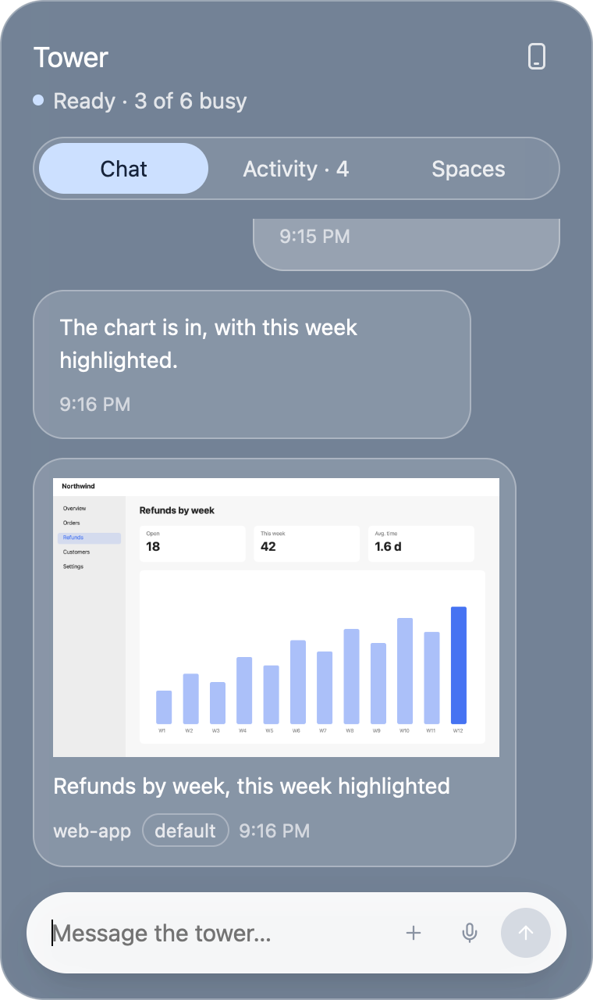
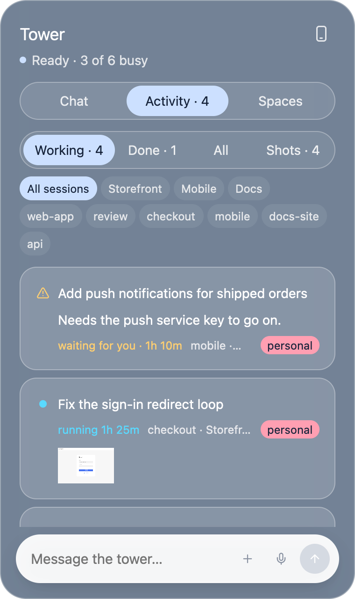
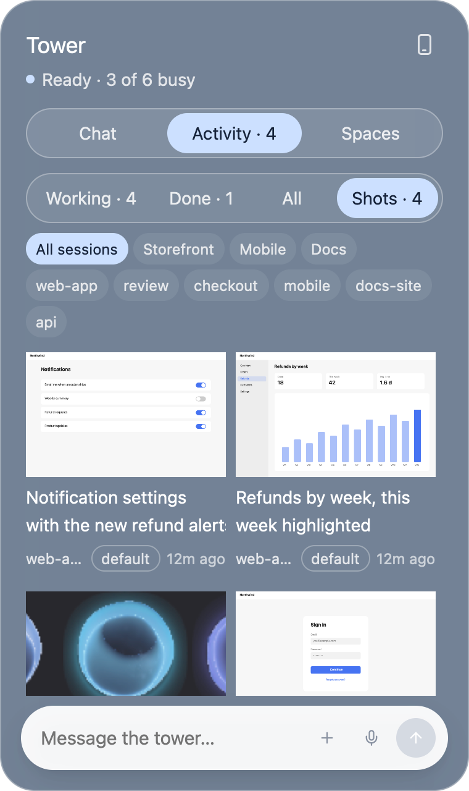
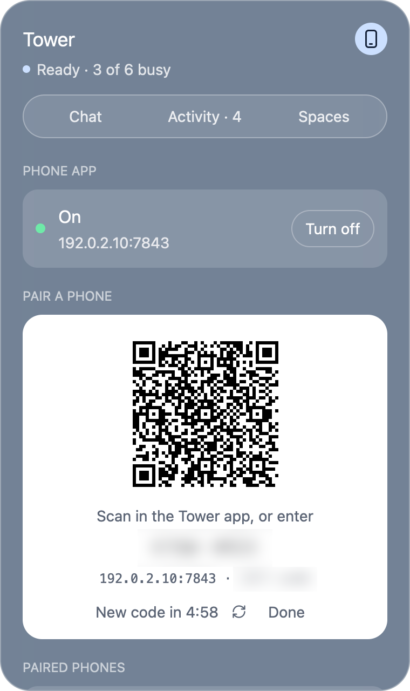

# herdr-tower

A voice control tower for [Herdr](https://herdr.dev). Talk to it, and it
steers every Claude Code and Codex session you run in Herdr, on this Mac and
on every machine added with `hc machine add`. It answers out loud.

<p align="center">
  
</p>

<table>
  <tr>
    <td align="center"><br><sub>Chat: replies, with the screenshots sessions send</sub></td>
    <td align="center"><br><sub>Attach pictures and files as tokens</sub></td>
  </tr>
  <tr>
    <td align="center"><br><sub>Activity: jobs, their Claude accounts and screenshots</sub></td>
    <td align="center"><br><sub>Shots: the gallery of visual results</sub></td>
  </tr>
  <tr>
    <td align="center"><br><sub>Dictation: your words appear as you talk</sub></td>
    <td align="center"><br><sub>Phone: pair the Android app with a QR</sub></td>
  </tr>
  <tr>
    <td align="center"><br><sub>The brain at work, from its own hooks</sub></td>
    <td align="center"><br><sub>Spaces: focus one, hold the rest</sub></td>
  </tr>
</table>

<p align="center">
  <br><sub>Click a screenshot for the full-size viewer: fit or 100%, ← → through the rest, Esc to close</sub>
</p>

Everything that listens and speaks runs locally, in one Rust binary:

| Part | What | How |
|---|---|---|
| Ears | Whisper large-v3-turbo (q5) | [whisper-rs](https://crates.io/crates/whisper-rs) → whisper.cpp on Metal, in process |
| Mouth | Kokoro-82M | [loqui](https://crates.io/crates/loqui) → ONNX Runtime with a pure-Rust G2P (no espeak, no Python) |
| Microphone, speakers | | cpal, rodio |
| Radar | every terminal's status | `hc events` here, `hc exec --on <machine> hc ls` there |
| Brain | a Claude Code (or Codex) session named `tower` | drives the others with `hc` |
| Talk key | Control, anywhere on the Mac | a listen-only CGEventTap in the daemon |
| Window | `tower orb` ([GPUI](https://gpui.rs), Zed's UI framework) | one floating orb: how it moves says what the tower is doing |

Measured on an M5 Pro: Kokoro makes speech about 8× faster than real time
(first sentence in ~0.2 s); Whisper turbo transcribes a 4-second request in
~0.5 s.

## Use

```sh
tower up            # the orb, the voice (Herdr terminal tower-voice) and the brain (terminal tower)
tower up --show     # ... and show the brain in a Herdr tab
tower up --no-orb   # ... without the orb
tower down          # stop the voice and the brain (the orb stays, faded: click it to start again)
tower orb           # just the orb
```

Then:

- **Tap Control** (alone, anywhere on the Mac): speak; a pause ends the take,
  another tap sends it at once. **Hold Control**: talk while holding, let go
  to send. Control with another key (ctrl-c, ctrl-r, ...) is left alone.
  Talking over the tower hushes it.
- **The orb** floats over every window, on every Space: a small cup of
  liquid that turns, wobbles and boils. Its mood follows the tower: calm and
  pale blue when ready, icy cyan with a breathing halo while it listens to
  you, periwinkle with a halo that throbs on each beat while it replies, lively and
  spinning while it understands, its opening turned up while it thinks, a
  quicker beat while it speaks, faded when off, breathing in standby, with a
  red dot when an agent needs you. It reaches for the pointer, gives where you
  press it and sloshes when dragged. Hover for the last thing heard or said;
  click for the panel (below); right-click to show the tower's own terminal; drag it
  anywhere (it comes back there next time). ⌘⇧K, from any app, shows or hides
  it. It is its own small window (no Dock icon), so it works with Herdr closed.
- ⌘⇧Space also talks and ⌘⇧Esc hushes, from any app (the orb handles them).
- `tower mode handsfree`: always listening; start with "Tower, ..."; say
  "stop" or "hush" to cut it off. `tower mode ptt` is the default.

The orb is the liquid orb from the orbs prototype (`eyz/orbs`, `index.html`
with its default settings) rewritten in Rust: its liquid-drop physics in
`src/orb/liquid.rs` and `src/orb/sim.rs`, its raymarched shell as a Metal
shader in `src/orb/orb.metal` (GPUI draws everything else on top). A light
screen gets the prototype's light look (navy on beige), a dark one its glow
look (blue on black); either backdrop becomes transparency.
`HERDER_TOWER_ORB_LOOK=light` or `glow` picks one. How each phase moves it
is `Drive` in `src/orb/render.rs`.

The orb used to be a Herdr mod showing the `orb-*.png` artwork; its source
is still in `mod/tower`, but `tower install` no longer puts it in Herdr, and
takes the keys it added (⌘⇧K, ⌘⇧Space, ⌘⇧Esc) out of Herdr's `keys.json`:
the orb has them now.

### The panel

Click the orb for a glass chat with the tower (built with
[GPUI Kit](https://gpui-kit.com) on macOS's own blur): your messages on the
right, its answers on the left, what the sessions reported in between.
Type in the pill at the bottom: Enter sends, Shift+Enter starts a new line,
Esc closes. While you talk (Control or ⌘⇧Space), what you say appears in it as you say it, transcribed every second or so, then the final text, which goes to the brain as any spoken request. If the input already holds a draft (text you typed, an image or file you attached), what you say is added after it instead, and nothing goes until you press Enter, which sends the text and the attachments together.

When a session asks something the tower leaves to you (see "who decides" in [docs/questions.md](docs/questions.md)), a card waits at the foot of the chat, and the session's job card says "Asks: …" with a link to it. One question at a time, as the terminal dialog: the tower's three recommendations as large answers (the first marked Recommended, with why; a spinner while they come, and you can answer already), the session's own choices one tap away, and **Other** for your own answer: type it, hold Control and say it, or add files. Several questions end with a review, then Submit; the tower types the answers into the session and the card says how it goes (answering, waiting for the session, or where it stopped). ✕ dismisses it. What the tower answered for you shows as a quiet line ("answered for you: …"). How much it answers by itself is in Settings (the gear): normal, keep moving, or ask me everything.

Attachments work as in Claude Code and Codex: paste a screenshot or a file
copied in Finder, drop files on the panel, or pick them with +. Each becomes a
token where you were typing, `[Image #1]`, `[Video #2]`, `[File #3: name]`;
delete the token and the file goes with it. The message reaches the brain like
a spoken request, with the files' paths in token order (copied to
`~/.local/share/herder-tower/attachments` first, so they stay put).

The jobs button (by the status) shows what the tower handed out, in progress
and finished, by space or session. It all lives in
`~/.local/share/herder-tower/history.jsonl` (append-only): `tower watch`
starts a job, the watch report ends it, the brain adds the outcome
(`tower job done`) and session summaries (`tower summary`).

Each Claude session, job and history row carries a small badge naming the
Claude account it runs on (the `account` the radar reports per agent); Codex
sessions have none. The panel has no list of accounts of its own: it shows
whatever name the data carries, outlines the default account (the first
`tower accounts` lists, re-read every 30 s) and fills any other account with a
colour picked from its name, so a new account needs no change here. A space shows its
account when all its Claude sessions share one, and "mixed" when they differ.

Things to say: "What's everyone doing?", "Tell the eyzflow session to run
the tests and fix what fails", "What is Codex on the VPS asking?", "Approve
it", "Start a Claude session in sooner-app-web and have it look at the login
bug" (add "on the <name> account" for another account). The brain hands off
work (`tower start` for new sessions), calls `tower watch`, and tells you when the
session finishes. When any agent anywhere needs you, the radar says so.

### Claude accounts

The tower knows nothing about your accounts itself: it asks the
claude-accounts mod (the `cca` command, in the Herdr header) each time.
`cca --porcelain` lists the accounts, the first being the default (cca's
`default`: `~/.claude`, with `CLAUDE_CONFIG_DIR` unset). `cca --porcelain
<pid>` names the account a running `claude` uses, from the
`CLAUDE_CONFIG_DIR` in its environment. Add an account with `cca add <name>`
and the tower can use it straight away.

```sh
tower accounts                      # the accounts cca knows; * is the default
tower start --name fix-login --cwd ~/w/app "look at the login bug"
tower start --account <name> --name fix-login --cwd ~/w/app "..."
tower start --on vps --name x "..." # uses cca on that machine, if it has it
tower start --space ticket --name x "..."  # in the space whose name has "ticket" in it
```

`tower start` runs `hc run --bg --outlive-parent ... -- cca <account> -n
<name> "<task>"`: cca sets (or unsets) `CLAUDE_CONFIG_DIR` and `CCA_ACCOUNT`
and starts claude. It records a job in the history with the account, and
watches the session (`--no-watch` not to). `--space <name>` puts it in a new
tab of that Herdr space (its whole name or a part of it; none or several
matching is an error that lists them), through Herdr's `tab.new`, running the
same `cca` command; the window stays on the space it showed. Without
`--space` it gets a tab in the space the window shows. Either way it says which
space the session went to. An account cca doesn't know is an
error that lists the ones it does. Without the mod, sessions start as plain
`claude` and accounts show as unknown.

Every Claude session on this Mac carries its account: `tower agents`,
`tower spaces`, `tower history` and jobs, and the `agents` in the daemon's
`state.json` (the orb's panel). It's the account's name as cca has it, or
`null` for Codex, other machines, and sessions it can't tell. A process's
account never changes, so it's looked up once per pid and kept in
`~/.local/state/herder-tower/accounts.json`.

### Behaviors

How the tower works is a list of **behaviors** you can read and change:
how it talks, hands out and watches work, spaces, accounts, releases and
safety, which questions it answers for you, screenshots, browsers. Each is a
short rule with a one-line summary, on or off, in
`~/.config/herder-tower/behaviors/`; the brain's instructions are generated
from them (plus a fixed core with its tools). Change them in the panel or
on the phone, with `tower behavior …`, or just say it: "from now on, always
…", "change the screenshot behavior to …", "turn off …", "undo that".
Every change is logged and can be undone, and shows in the chat with what
changed. Details: [docs/behaviors.md](docs/behaviors.md).

In the panel: Settings (the gear) → **Behaviors**, or tap a behavior change
in the chat. Each category is a section and each behavior a card: its name,
its line, where it came from (built in, you, learned) and a switch. Tap one
for the whole rule, with Edit (Preview shows what changes before Save), Turn
off, Delete (asked twice) and Undo; **+ Add** writes a new one; the search
finds any word; the fixed core is folded away at the end, with the recent
changes. The input at the foot says "Tell the tower what to change…": type
or hold Control and say it, and the tower does it and answers in a line.

### Screenshots

Sessions show visual results in the tower: `tower screenshot shot.png
--caption "the new login page"` (several images at once; PNG, JPEG, WebP or
GIF up to 15 MB). The tower keeps a copy for 30 days and records it in its
history (kind `screenshot`, with the session, its account, its job), so it
appears in the orb's panel and on the phone. `tower screenshots --last 5`
lists them. The brain asks sessions doing visual work to send one; the
instruction block for sessions is in
[docs/session-instructions.md](docs/session-instructions.md).

Screenshots show in the panel's chat as they arrive: one card per go, with
the picture large enough to read, its caption, the session and its account.
The tower can also put them with its own message: `[shot:<id>]` or
`[shots:<session>]` in its reply shows that screenshot (or the session's
latest ones, up to 4) under the message instead; the marker is never spoken
or shown.

In the panel, **Activity → Shots** is the gallery, newest first: each
thumbnail with its caption, the session and its account (the session and
space chips narrow it). A job's screenshots also show small on its card.
Click one to see it full size over the screen: it fits the screen, a click
shows it at 100% (scroll to look around), ← and → go through the others,
and Esc, ✕ or a click outside closes it. Thumbnails are made once, in the
background, the first time one is shown.

### The phone: Tower for Android

**Tower for Android** ([github.com/hasangilak/herdr-tower-android](https://github.com/hasangilak/herdr-tower-android),
`git@github.com:hasangilak/herdr-tower-android.git`) is the tower in your
pocket, over the local network. It mirrors the panel: chat with the tower,
spaces and their sessions (with their Claude accounts), running and finished
jobs, history, and the screenshots sessions send (a gallery and a full-size
viewer). It acts like the panel: ask (typed or dictated, with pictures and
files attached), approve or refuse what a blocked agent asks, focus a space,
hush. And it can be **the tower's voice**: you talk into the phone, the Mac
transcribes with its own Whisper, and the replies (and the "Okay.") play on
the phone in the tower's Kokoro voice while the Mac stays silent.

To connect it:

1. `tower phone enable` (the phone API is off until you do).
2. Pair: open the panel's **Phone** section and press **Pair a phone** for
   a QR code, or run `tower phone pair` in a terminal. Scan the QR in the app
   (or type the address and the 8-digit code; the code works once, for 5
   minutes).
3. `tower phone devices` lists paired phones; `tower phone revoke <id|all>`
   forgets one at once.

It is HTTPS only, with a certificate the Mac makes for itself and the phone
pins (its fingerprint is in the QR); it listens only on the Mac's private LAN
address; and every call needs the paired phone's token, which the Mac keeps
only as a hash. The API, the pairing flow and the security model:
[docs/mobile-api.md](docs/mobile-api.md).

The panel does the same without a terminal: Settings (the gear at its top
right) shows whether the phone API is on and where it listens, turns it on or
off, and **Pair a phone** shows the QR code (and the code to type) with its
5-minute countdown, opening a fresh one when it runs out. Below it are the
paired phones, each with Revoke and **Replies: Phone | Mac**: where the
tower's replies to what that phone sends are heard.

From a shell (or a Raycast/skhd hotkey outside Herdr):

```sh
tower talk | tower hush | tower mode handsfree
tower ask "what's waiting for me?"   # typed instead of spoken
tower say "hello"                    # speak anything
tower agents                         # every agent on every machine, with its account (JSON when piped)
tower accounts                       # the Claude accounts (from cca)
tower phone pair                     # pair the Android app (tower phone enable first)
tower screenshot shot.png --caption "…"  # show a visual result in the panel and on the phone
tower behavior list                  # how the tower works; add, edit, disable, remove, undo
tower start --name n --cwd d "task"  # a new Claude session on an account (--account), watched
tower history [--jobs open|finished] [--session t3]   # what the tower has done (JSON when piped)
tower job start|done|failed <t> "…"  # record a job (the brain does this)
tower summary <t> "…"                # record what a session has done (the brain does this)
tower status                         # the daemon's state
tower doctor                         # check the setup
tower selftest                       # Kokoro speaks, Whisper listens: no mic needed
```

## Install

```sh
brew install cmake          # whisper.cpp builds with it
cargo build --release       # GPUI compiles its Metal shaders at launch: no Metal Toolchain needed
./target/release/tower install
tower up
```

`install` puts the binary in `~/.local/bin/tower`, writes
`~/.config/herder-tower/config.toml` (voice, Whisper model, wake words,
alerts) and the brain's folder `~/.config/herder-tower/brain/` (its
instructions and Claude Code hooks). The first `tower up`
downloads Kokoro (~330 MB) to `~/.cache/loqui`. The Whisper model is
`~/.local/share/herder-tower/models/ggml-large-v3-turbo-q5_0.bin` (from
`huggingface.co/ggerganov/whisper.cpp`). macOS asks once for microphone access
for **Herdr Core**, because the voice runs in a Herdr terminal.

## How it fits together

```
 you ─ mic ─▶ tower-voice (Rust daemon) ─ hc send "[voice] …" ─▶ tower (Claude Code)
                 ▲  │                                              │  hc ls/read/send/keys
                 │  └─ state.json ─▶ tower orb (its own window)    ▼
     Stop hook ──┘◀── its answer ──────────────────────────── every agent, every machine
     (tower hook claude)                    radar: hc events / hc exec --on <m> hc ls
```

- The brain's last message each turn goes through its Stop hook to the
  daemon, which strips markdown and speaks it a sentence at a time.
- `tower watch <t>` (the brain calls it after handing off work) makes the
  daemon send the brain a `[watch]` message when that session stops working,
  is blocked, or sits on a first-run "trust this folder?" question.
  Watches survive restarts: `~/.local/state/herder-tower/watches.json` keeps
  them, the last status of every agent, and reports the brain hasn't taken
  yet. On start the voice compares that with what Herdr says now and reports
  what finished, blocked or ended while it was down, for watched sessions and
  for sessions with an open job. A watch leaves the file in the same write
  that queues its report, so each finish is told once, and a report waits
  (said out loud once) until the brain is there to take it.
- Codex as the brain: `tower up --brain codex` (it uses Codex's `notify`
  instead of a hook, and runs with `--sandbox danger-full-access
  --ask-for-approval on-request` because `hc` talks to herdr-core over a Unix
  socket).

## Limits

- No acoustic echo cancellation yet: in hands-free mode the tower ignores
  what it hears while it talks, except a stop word. A loud speaker can
  drown a spoken "stop"; press ⌘⇧Esc or Talk instead, or use headphones.
  (macOS voice processing via AVAudioEngine would fix this.)
- The Control key needs Input Monitoring for Herdr Core (System Settings >
  Privacy & Security). Set `talk_key = "right_ctrl"` (or `off`) in
  config.toml if plain Control taps get in your way.
- Other machines are polled every 15 s, so their alerts lag a little.
