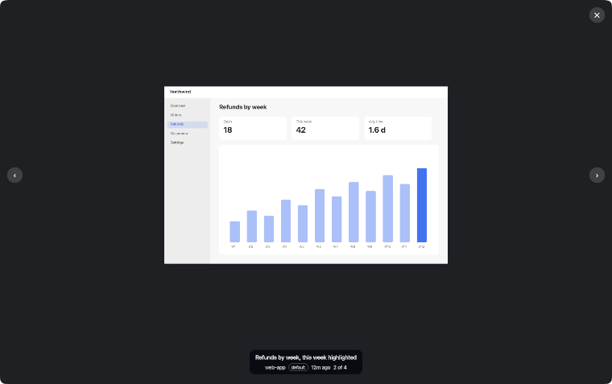
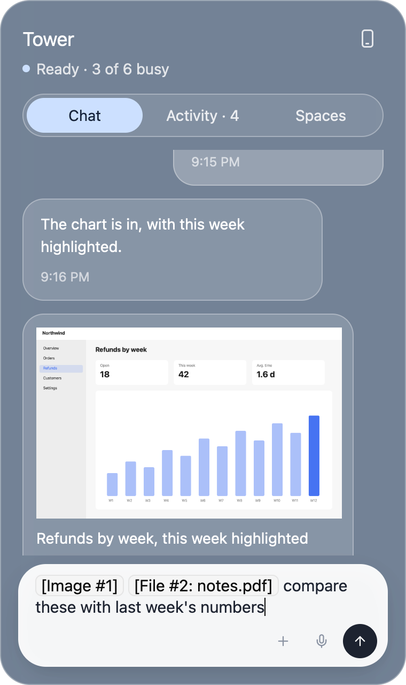
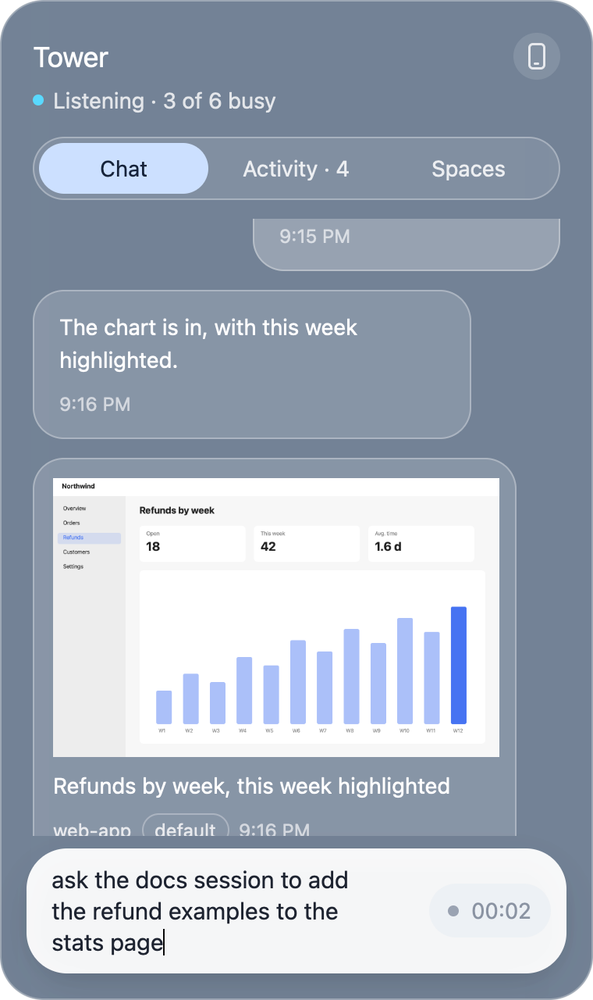
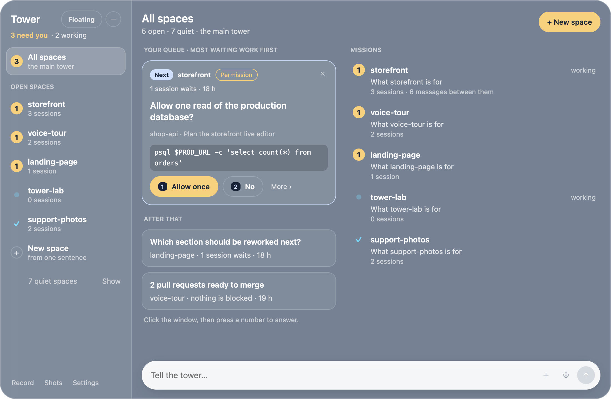
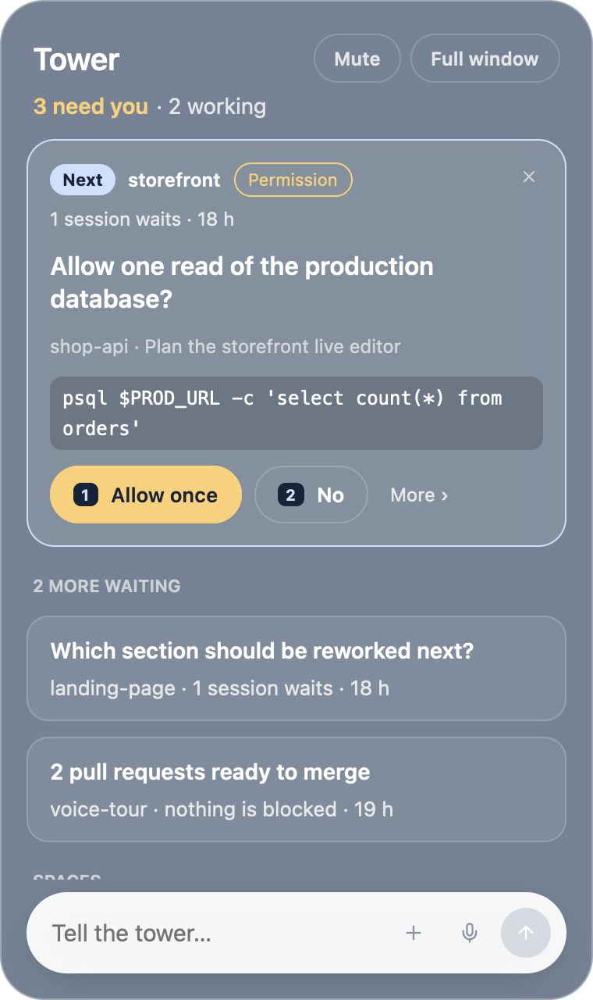
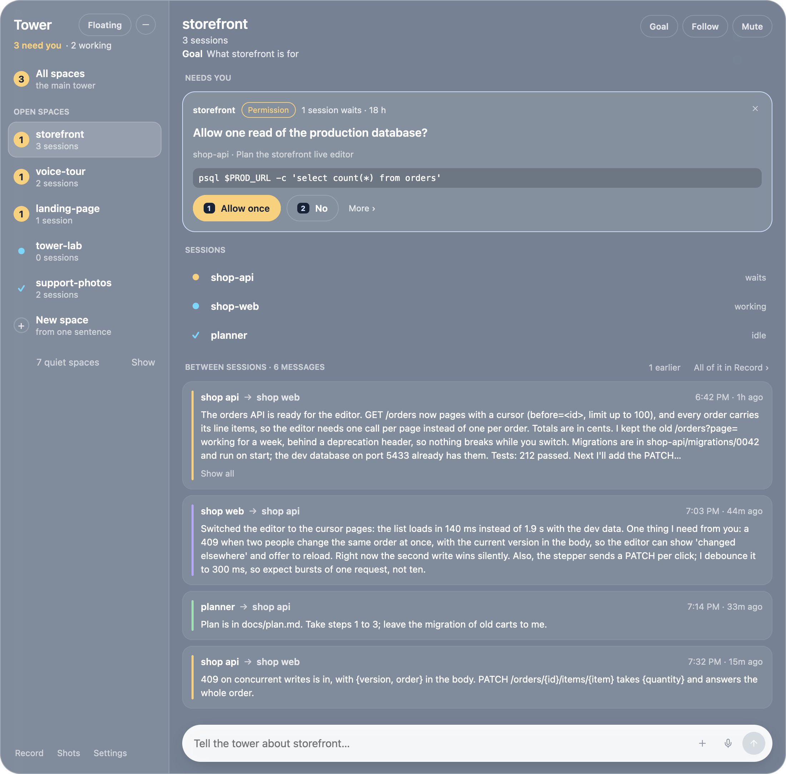
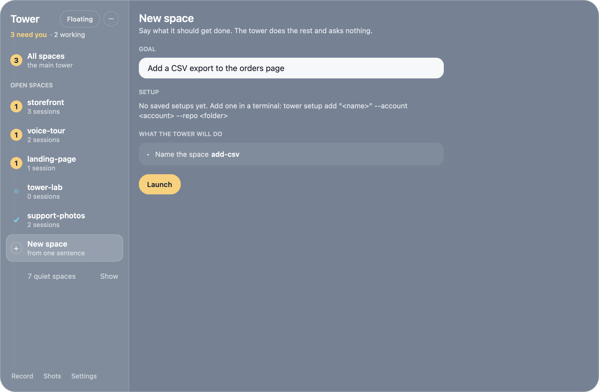
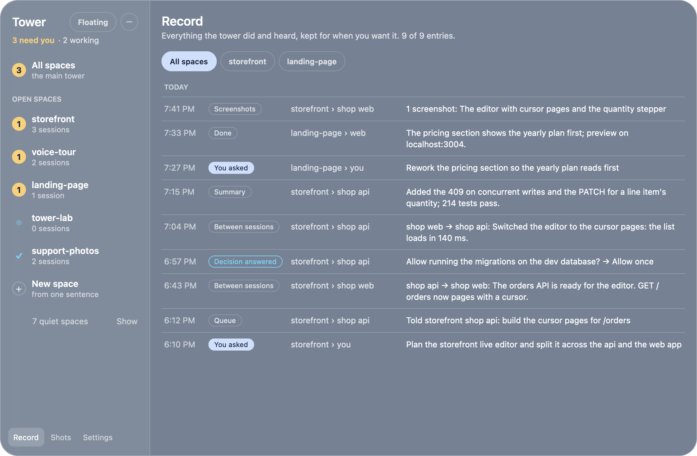
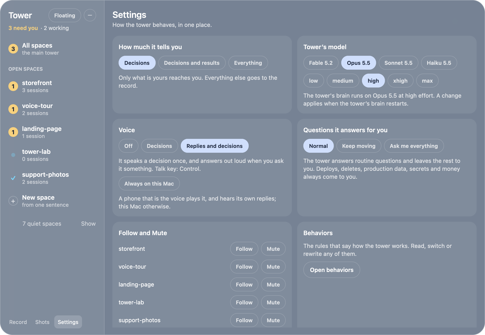

# herdr-tower

A voice control tower for [Herdr](https://herdr.dev). Talk to it, and it
steers every Claude Code and Codex session you run in Herdr, on this Mac and
on every machine added with `hc machine add`. It answers out loud.

<p align="center">
  
</p>

<p align="center">
  <br><sub>Click a screenshot for the full-size viewer: fit or 100%, ← → through the rest, Esc to close</sub>
</p>

<table>
  <tr>
    <td align="center"><br><sub>Attach pictures and files as tokens (pictured in the panel as it was: the input is the same)</sub></td>
    <td align="center"><br><sub>Dictation: your words appear as you talk (pictured in the panel as it was)</sub></td>
  </tr>
</table>

### The Quiet Tower

It speaks only when you asked or the decision is yours. Everything else
goes to the record. (Pictured with made-up spaces and sessions.)

<p align="center">
  <br><sub>The full window: one queue for every space, most waiting work first; the next card answers with a number key</sub>
</p>

<table>
  <tr>
    <td align="center" width="34%"><br><sub>The floating panel beside the orb: the same queue at a glance</sub></td>
    <td align="center"><br><sub>A space as a mission: what needs you there, its sessions, and what they wrote to each other (a click opens a message whole)</sub></td>
  </tr>
  <tr>
    <td align="center" colspan="2"><br><sub>A new space from one sentence: the tower names it, opens its sessions and worktrees, and asks nothing</sub></td>
  </tr>
  <tr>
    <td align="center" colspan="2"><br><sub>The record: everything it did and heard, by space, for when you want it</sub></td>
  </tr>
  <tr>
    <td align="center" colspan="2"><br><sub>Settings: how much it tells you, the model its brains run on, what it says out loud</sub></td>
  </tr>
</table>

The design and every state of both windows is drawn in
[docs/quiet-tower.html](docs/quiet-tower.html); the contract is
[docs/quiet-tower.md](docs/quiet-tower.md).

Everything that listens and speaks runs locally, in one Rust binary:

| Part | What | How |
|---|---|---|
| Ears | Whisper large-v3-turbo (q5) | [whisper-rs](https://crates.io/crates/whisper-rs) → whisper.cpp on Metal, in process |
| Mouth | Kokoro-82M | [loqui](https://crates.io/crates/loqui) → ONNX Runtime with a pure-Rust G2P (no espeak, no Python) |
| Microphone, speakers | | cpal, rodio |
| Radar | every terminal's status | `hc events` here, `hc exec --on <machine> hc ls` there |
| Brain | a Claude Code (or Codex) session named `tower` | drives the others with `hc` |
| Talk key | Control, anywhere on the Mac | a listen-only CGEventTap in the daemon |
| Window | `tower orb` ([GPUI](https://gpui.rs), Zed's UI framework) | one floating orb (how it moves says what the tower is doing, its number how many decisions wait), its panel and the full window |

Measured on an M5 Pro: Kokoro makes speech about 8× faster than real time
(first sentence in ~0.2 s); Whisper turbo transcribes a 4-second request in
~0.5 s.

## Use

```sh
tower up            # the orb, the voice (Herdr terminal tower-voice) and the brain (terminal tower)
tower up --show     # ... and show the brain in a Herdr tab
tower up --no-orb   # ... without the orb
tower down          # stop the voice and the brains (the orb stays, faded: click it to start again)
tower model [<model>] [--effort <level>] [--restart]   # what the tower's brains run on (default: claude-opus-5-5 at high effort); a change applies when a brain restarts
tower mute on|off|toggle|status   # the tower says nothing, on the Mac or a phone; cards and replies still appear (kept across restarts)
tower mac-voice on|off|toggle|status   # play everything it says on this Mac, never on a phone (full window: Settings > Voice; kept in config.toml)
tower tell [decisions|results|everything]   # how much it tells you: what you must decide (the default), also a receipt per finished request, or every note as before
tower tell --voice off|decisions|replies    # what it says out loud: nothing, a decision once and nothing else, or its answers too (the default)
tower undo [<id>] [--force]         # take back what the tower just opened for you (a session, a launched space); tower acts lists what it opened and what it assumed
tower decisions [--space <space>]   # what only you can decide, most pressing first; tower answer <id> --choice <n> | --other "…", tower dismiss <id>
tower orb           # just the orb
```

Then:

- **Tap Control** (alone, anywhere on the Mac): speak; a pause ends the take,
  another tap sends it at once. **Hold Control**: talk while holding, let go
  to send. Control with another key (ctrl-c, ctrl-r, ...) is left alone.
  Talking over the tower hushes it.
- **The orb** floats over every window, on every Space: a small cup of
  liquid that turns, wobbles and boils. Its mood follows the tower: calm and
  pale blue when ready, icy cyan with a breathing halo while it listens to
  you, periwinkle with a halo that throbs on each beat while it replies, lively and
  spinning while it understands, its opening turned up while it thinks, a
  quicker beat while it speaks, faded when off, breathing in standby. An
  amber number on it says how many decisions wait for you (those of muted
  spaces left out; no number when there are none; `9+` past nine). It
  reaches for the pointer, gives where you press it and sloshes when
  dragged. Hover to peek at the panel (below): it goes when the pointer
  leaves the orb and the panel; a click inside it keeps it, with the
  keyboard. A click on the orb opens the panel when it isn't showing and
  closes it when it is (a peek or kept), and it doesn't peek again until the
  pointer has left the orb; Esc closes it too. Right-click shows the tower's own terminal,
  ⌥-click mutes or unmutes the tower; drag it anywhere (it comes back there
  next time). ⌘⇧K, from any app, shows or hides it. It is its own small
  window (no Dock icon), so it works with Herdr closed.
  `HERDER_TOWER_ORB_PEEK=off` keeps hovering to one line (what it last heard
  or said).
- ⌘⇧Space also talks and ⌘⇧Esc hushes, from any app (the orb handles them).
- `tower mode handsfree`: always listening; start with "Tower, ..."; say
  "stop" or "hush" to cut it off. `tower mode ptt` is the default.

The orb is the liquid orb from the orbs prototype (`eyz/orbs`, `index.html`
with its default settings) rewritten in Rust: its liquid-drop physics in
`src/orb/liquid.rs` and `src/orb/sim.rs`, its raymarched shell as a Metal
shader in `src/orb/orb.metal` (GPUI draws everything else on top). A light
screen gets the prototype's light look (navy on beige), a dark one its glow
look (blue on black); either backdrop becomes transparency.
`HERDER_TOWER_ORB_LOOK=light` or `glow` picks one. How each phase moves it
is `Drive` in `src/orb/render.rs`.

The orb used to be a Herdr mod showing the `orb-*.png` artwork; its source
is still in `mod/tower`, but `tower install` no longer puts it in Herdr, and
takes the keys it added (⌘⇧K, ⌘⇧Space, ⌘⇧Esc) out of Herdr's `keys.json`:
the orb has them now.

### The quiet tower

The tower does the work and keeps the record. It puts something in front of
you in two cases: you asked, or the decision is yours. Everything else it
writes down. The whole design is in
[docs/quiet-tower.md](docs/quiet-tower.md).

**How much it tells you** is one setting, `tower tell` (or Settings in the
full window; `[tell] level` in config.toml):

- `decisions` (the default): only what is yours to decide, and answers to
  what you ask. Finishes, deliveries, routine answers and the brain's own
  notes go to the record, unspoken.
- `results`: also one receipt when a request you made is finished.
- `everything`: every delivery, finish and note is told and spoken, as the
  tower did before. (The windows below still show the queue and the reply
  to what you asked; all of it is in the Record.)

**What it says out loud** is a second setting, `tower tell --voice` (or
Settings > Voice; `[tell] voice` in config.toml): `off` (nothing: the same
as `tower mute on`), `decisions` (a decision, once, in one sentence, and
nothing else) or `replies` (the default: it also answers out loud when you
ask it something). `tower mute off` goes back to whichever of the two it
was.

**A command gets a receipt, never a question.** Ask for a session or a
space and the tower takes the defaults, opens it, and keeps what it opened
and what it assumed (the account, the model, the folder or worktree, the
space, the name): the reply shows that as a line with chips and an
**Undo** button. `tower undo` ends what was opened (and removes the
worktrees made for it, when nothing in them would be lost); it refuses,
saying why, when a session was given more work since or its worktree holds
changes, unless `--force`.

**Names you can read.** A session is its space and what it works on:
`sandbox › mediaroom` where it is written, "the mediaroom session in
sandbox" where it is said (its own name when it has one, else its project).

Per space, `tower space follow <space>` lets that space's receipts reach
you as they land, and `tower space mute <space>` keeps its decisions in its
own view, off the orb's number and out of the main queue (`unfollow`,
`unmute` undo them).

**A decision** is the one thing shown to you as a card: a question a session
asks that the tower leaves to you, a turn that ended waiting for you, the
pull requests of one repo waiting for your merge in one space, something
the brain raised (`tower raise`), or a task that failed again after the
tower sent it once more. The same thing from several sessions of a space is
one decision with all of them waiting, told once. They form **the queue**,
ordered by sessions waiting × how long they have waited, heaviest first.
`tower decisions` lists it; `tower answer <id> --choice <n>` or `--other
"<your words>"` answers one, `tower dismiss <id>` takes one off.

### The floating panel

Hover the orb, or click it: a glass panel, 380 × 640 (built with
[GPUI Kit](https://gpui-kit.com) on macOS's own blur). It shows what needs
you and nothing else:

- **The status line**: how many decisions are yours, in amber, and how many
  spaces have a session at work; under it, faintly, what the tower last
  heard or said. **Mute** is the tower-wide mute; **Full window** opens the
  window below in this panel's place: the panel closes.
- **The queue**: one card open, tagged **Next**, the rest as rows under "N
  more waiting"; a click on a row opens it instead (**Picked**). A card says
  its space, why it is yours, how many sessions wait and for how long, and
  what is asked.
- **The spaces**: each open space as a chip: an amber count of what needs
  you there (an outline when the space is muted), a pulse while it works, a
  tick at rest; "+ N quiet" for the rest. A chip opens that space in the
  full window.
- **The reply** to what you last asked the tower, above the input, for ten
  minutes (✕ closes it, a click leads to the record); while the tower works
  on it, one line of what it is doing. When the tower opened something for
  it, the reply is its receipt: what was opened, what was assumed as chips
  (why, on hover), and **Undo**; undone, it says "Closed it. Nothing else
  changed."
- **Make it a rule**: after you answer a card, its receipt line stays about
  eight seconds with "Make it a rule". One tap asks the tower of that space
  to answer that question that way from now on (a behavior you can read,
  change or undo). It is never offered for a merge, a permission, a failed
  task, or anything about a deploy, a delete, production data, secrets or
  money.
- **The input**: type in the pill at the bottom: Enter sends, Shift+Enter
  starts a new line, Esc closes the panel. While you talk (Control or
  ⌘⇧Space), what you say appears in it as you say it, transcribed every
  second or so, then the final text, which goes to the brain as any spoken
  request. If the input already holds a draft (text you typed, an image or
  file you attached), what you say is added after it instead, and nothing
  goes until you press Enter, which sends the text and the attachments
  together.

**Cards.** A question a session asks goes one question at a time, as the
terminal dialog does: the tower's three recommendations as answers (the
first its pick, with why; placeholders while they come), the session's own
options one tap away, and **Other** for your own answer: type it, hold
Control and say it, or add files. A tap on an answer of a single question
sends it; several questions end with a review, then Submit. The tower
types the answers into the session, the card says how that goes, and when
several sessions asked the same thing they all get the answer. If typing
stops half way, the card says so and offers the session or another try. A
merge card lists its pull requests, into dev before into main, each with
its checks and where its review stands ("Review: 2 critical, round 2",
in amber until it is agreed); its button asks about one (a review that
isn't agreed is said among what to mind, and the merge is still yours), "Confirm" merges it (a PR whose
checks fail takes a third step, from its own row; a draft or a conflict is
held back). "Merge all 3" is confirmed once for the whole chain, and the
tower merges the PRs in order by itself: it waits for GitHub between
them, has a PR that fell behind or conflicts fixed by its session, and
only hands one back to you (once, saying why) when it can't be fixed. What the brain raised shows its choices as buttons, the
tower's pick in amber with its reason, and Other; a task that failed twice
offers "Try again" and "Drop it". An answered card leaves a one-line
receipt for about two seconds. ✕ dismisses a card.

**Number keys** answer the open card: 1 is its first answer, 2 the next, and
on a merge or a review they press its buttons. They count while the message
is empty and no other field has the keyboard (a Persian or Arabic
keyboard's digits too).

### The full window

"Full window" opens the tower's window in the floating panel's place (the
panel closes), about 960 × 640 at first, the same glass. Move it by its top
(the header strip, or "Tower" at the top of its sidebar) and resize it by
its edges, down to 820 × 520; it opens where you left it, at that size.
The orb remembers which of the two you use. Once you open the full window
you are in full mode: a click on the orb minimizes the full window into the
orb, kept as it is (the same page, what you typed), and the next click
brings it back; hovering the orb doesn't bring up the floating panel. Esc
and the round minimize button beside "Floating" minimize it too.
**Floating**, beside
"Tower", switches back: the full window closes, the floating panel opens,
and the orb opens the floating panel from then on. The mode is kept in
`window.json` with the window's spot and size. Both windows show one model:
a card answered or picked in one is so in the other. A sidebar on the left: **All spaces** with the count of what is
yours, each open space with its mark and a line (its sessions, "standing",
"ready to close"), **New space**, the quiet spaces and what closed today
folded into one line, and **Record**, **Shots**, **Projects** and
**Settings** at the foot. The pane beside it shows:

- **All spaces**: the queue, beside the open spaces as missions: each
  one's goal (or what it is asked now), how far its request is ("3 of 5",
  "ready to close"), its sessions, whether they have their own worktrees,
  and how many messages they wrote each other.
- **A space**: its goal and what counts as done (the **Goal** button
  changes them, or makes it a standing space), **Follow**, **Mute** and
  **Review PRs** (with a line per open PR on where its review stands), its
  closing report with **Close this space** once it is ready (and when it
  would close by itself), what needs you there (a muted space's decisions
  show only here), its requests, its sessions (status, last words, worktree
  and branch, dev port), and the latest of the thread between its sessions:
  who wrote to whom and when, each message's first lines, and the whole of
  it (with Copy) on a click.
  Its head says when it has a tower of its own; what you type under it
  goes to that tower, and its reply shows there (with none running: to the
  main tower, with the space named).
- **A session** (a click on its row): what it was asked, what it last
  said, its screen as it is now (read again every couple of seconds), the
  card that waits on it, and **Show in Herdr**.
- **New space**: a goal, or a whole ticket pasted as it is, and a
  **Project** (none picked: the tower's brain picks). A goal whose first
  line names the repos ("open sessions in eyzflow and mediaroom: …") shows
  what the tower will do (the name it gives the space, the sessions it
  opens and on which account, their worktrees), and **Launch** is the
  confirm. Any other goal gets **Draft the space**: the tower's brain reads
  the ticket ("Reading the ticket…", a few seconds) and shows the draft as
  a card: the space's name, its goal (the ticket's title), done when (its
  acceptance criteria), each session's repo and why it is in it, and the
  project and account, with a **Review its PRs** switch under it (on: each
  PR its sessions open gets a reviewer; it is under the plan of a goal
  whose first line names its repos too). **Launch** opens exactly that; **Adjust it in
  words…** with **Redraft** gets a new draft in its place ("leave the
  dashboard out", "call it msg-translation"); **Start over** drops it.
  Nothing opens before Launch. The whole ticket goes to the sessions as
  their brief; the space's header keeps the title.
  **Plan as a page** or **Plan as a whiteboard**, under the draft, shows
  you the plan before anything opens: the tower's planner (a Claude Code
  terminal of the tower's, `tower-planner`, on your default account and the
  brains' model) reads the ticket, the draft and the repos, writes the full
  plan (each session's part and its order, how the repos fit together, the
  risks, the open questions, how it is tested) and publishes it to your
  claude.ai account, private, as an HTML page or a Whiteboard ("The tower's
  brain is writing the plan… (it reads the repos first: about five minutes)", then **Plan · page ·
  Open**). Under the card is the chat about it: ask about the plan or
  change it ("which session starts first?", "leave the dashboard out") in
  "Ask about the plan or change it…" with **Send**; the planner's answers
  come in under yours, a change it makes to the draft shows on the card,
  and a change to the plan republishes the same artifact. A planner that
  waits on a question in its terminal (a permission to publish) says so,
  with **Show in Herdr**; one that fails says why, with Plan again.
  **Launch** then hands each session the plan's link and its own part of
  the plan; **Start over** ends the plan. The planner never launches,
  opens a session or edits a repo.
- **Record**: the history, newest first, each row with its time, what it is
  (You asked, Tower replied, Started, Finished, Needs you, Between
  sessions, Answered for you, Note, Receipt, Decision raised, Decision
  answered, Ready to close, Space closed, …), where and who, and its words;
  chips narrow it to one space, and opened from inside a space it starts
  there.
- **Shots**: the gallery of what sessions sent (see Screenshots below).
- **Projects**: what the tower knows of your work, a card each: its name,
  account, what it is, and its repos with what each is for. **+ Add
  project** and **Edit** open one form (name, an account pick, about, and
  the repos one per line, `<folder> — <its role>`); **Remove** asks once.
  It saves through `tower setup add|remove`. The roles are what a draft
  reads to pick the repos a ticket needs.
- **Settings**: how much it tells you; the tower's model (the model and
  effort its brains are started on, what the running one uses, and
  **Restart the tower's brain** when a restart is needed for a change to
  apply); the voice (Off, Decisions, or Replies and decisions; and, as a
  switch of its own, always on this Mac); how many questions it answers for you; Follow and Mute per open
  space; the behaviors; pairing a phone; the Claude accounts; the
  projects, with the way to their page.

Screenshots carry a small badge naming the Claude account of the session
that sent them: the default account (the first `tower accounts` lists)
outlined, any other filled with a colour picked from its name. A space's
line says the account when all its sessions share one.

Attachments work as in Claude Code and Codex: paste a screenshot or a file
copied in Finder, drop files on the window, or pick them with +. Each becomes a
token where you were typing, `[Image #1]`, `[Video #2]`, `[File #3: name]`;
delete the token and the file goes with it. The message reaches the brain like
a spoken request, with the files' paths in token order (copied to
`~/.local/share/herder-tower/attachments` first, so they stay put).

What the tower hands out and what comes of it lives in
`~/.local/share/herder-tower/history.jsonl` (append-only), the file the
Record shows: `tower watch` starts a job, the watch report ends it, the
brain adds the outcome (`tower job done`) and session summaries (`tower
summary`). An entry with `"record": true` was written down, not told.

Things to say: "What's everyone doing?", "Tell the eyzflow session to run
the tests and fix what fails", "What is Codex on the VPS asking?", "Approve
it", "Start a Claude session in sooner-app-web and have it look at the login
bug" (add "on the <name> account" for another account), "Open a space for
the login redirect". The brain hands off work (`tower start` for new
sessions, `tower launch` for a space), calls `tower watch`, and answers
what you asked. What a session then needs from you comes as a decision;
its finish is in the record (or a receipt, at `tower tell results`).

### Spaces are missions

A space with a goal is a mission: it has a goal, what counts as done, and
an end. `tower space goal <space> "<goal>" [--done-when "<…>"]` sets them
(or the Goal button in the space's view).

- **open**: it has sessions at work.
- **quiet**: its last session is gone. What was raised there closes (a PR
  waiting for your merge stays yours). A day later it is archived: out of
  the listings, back when a session opens there again.
- **ready**: every request there is finished and nothing waits for you.
  The brain writes its closing report (`tower space report`), which the
  space's view shows with "Close this space".
- **closed**: `tower space close <space>` (your word, or the button) ends
  its sessions, removes the worktrees the tower made for it, each only when
  clean (one with uncommitted or unpushed work is kept and named; branches
  always stay), and puts its report in the record. It refuses while a
  session there works or waits for you, unless `--force` ("Close anyway").
  A ready space whose sessions have all been idle for `[spaces]
  auto_close_hours` (off by default; say 24 for a day) is closed the same way by itself.

A space with no goal is yours as it always was: never ready, never closed
by the tower, no worktrees. So is a **standing** space (`tower space
standing <space> on`), goal or not.

**One sentence opens a space.** `tower launch "Fix the login redirect"`
names the space from the goal (its first two words that carry meaning:
`fix-login`, with `-2` if that is taken), takes the repos (those its first
line names, else a project's), makes the Herdr space, opens a session per
repo on its account, sets the goal and hands the whole text out as the
first request. The space's goal is the ticket's title (the line after the
one that asks for sessions, else the first line) and what counts as done
is its "Acceptance criteria", "Definition of done" or "Done when" section,
if it has one. It asks nothing and prints what it assumed; `--dry-run`
prints the same plan and does nothing.

**A ticket drafts its own space.** `tower launch "<ticket>" --draft`
has the tower's brain read the ticket (one headless `claude -p` on your
default account, `[brains] model` at low effort, no tools, about 6 s)
beside your projects and every folder under the roots with a line on
each, and print the draft: the repos it needs and why, the space's name,
its goal, done-when, the project and account. Nothing is opened; a folder
the tower doesn't know is left out and said so. `--adjust "<what to
change>" --prior '<the draft's JSON>'` redrafts it. The draft is launched
as it is with `tower launch "<ticket>" --repo <folder> [--repo …] --name
<space> --title "<goal>" --done-when "<…>" [--account <a>] [--setup
<project>]`, which is what New space's Launch runs. In the full window,
New space has a conversation beside the form, as a space has: say the
ticket there, then what to change, and the brain drafts and redrafts it
there; Launch hands that conversation over (`--story-file <file>`), and
the new space's own conversation opens with how it was created.

**A draft is planned before it opens.** `tower plan new --form
page|whiteboard --draft '<the draft's JSON>' --ticket-file <file>` (New
space's **Plan as a page** / **Plan as a whiteboard**) starts the tower's
planner: one Claude Code terminal the tower owns (`tower-planner`, hidden,
on the default account and the `[brains]` model and effort, in
`~/.local/state/herder-tower/plans/<id>/` with `ticket.md`, `draft.json`,
`instructions.md` and the `plan.md` it writes). It writes the full plan,
publishes it as an Artifact on your claude.ai account (an HTML page, or a
Whiteboard from the account's Whiteboard type: a block per session, arrows
for what waits for what, a section for the risks and questions), and says
so (`tower plan published <id> --url <link>`). Then it waits: what you say
(`tower plan say <id> "…"`) reaches it through the send queue, its answers
come back the same way, and a change you agree to is a revised draft
(`tower plan draft <id> --json-file <f>`) and the same artifact
republished. One plan at a time: a new one, Start over or a launch ends
its planner. `tower launch … --plan <id>` gives each session the plan's
link and its own part of `plan.md` (6,000 characters at most), and closes
the plan. The planner may read anywhere, write only in its folder, and
run `tower plan`; it may never launch, start or queue anything, or edit a
repo.

A **project** (a setup, kept as `[[setups]]` in config.toml; the first is
the default) is a name, a Claude account, a line on what it is, and the
repos that get a session each with a line on what each is in it:

```sh
tower setup add "EYZFlow" --account default --about "the video platform agencies run on" \
  --repo "~/Work/eyz/eyzflow=the web app and its API" \
  --repo "eyz-mediaroom-serverless=the media backend"    # a folder's name is enough
tower setup add "EYZ" --was "EYZFlow" …                  # renamed in its place
tower setup remove "EYZFlow"
tower setups [--json]                                    # {"setups":[{"name","account","about","repos","roles":{repo: role}}]}
```

```toml
[[setups]]
name = "EYZFlow"
account = "default"
about = "the video platform agencies run on"
repos = ["~/Work/eyz/eyzflow", "~/Work/eyz/eyz-mediaroom-serverless"]
roles = { "~/Work/eyz/eyzflow" = "the web app and its API", "~/Work/eyz/eyz-mediaroom-serverless" = "the media backend" }
```

A table from before, with no `about` or `roles`, reads as it always did.

**Worktrees.** A session the tower opens for a mission (`tower launch`,
`tower start --space <space>`) works in a git worktree of its repo,
`<repo>/../.tower-worktrees/<space>/<repo>` on a branch `<space>/<repo>`,
with the repo's untracked `.env*` files copied over and a dev port of its
own from `[spaces] port_range` ("3000-3050"). Both are said in its first
instruction, kept on its terminal's labels and shown in its space's view.
Not in a space with no goal, a standing space, a folder that is no git
checkout, on another machine, or with `tower start --no-worktree`;
`[spaces] worktrees = false` turns it off everywhere. Such a space opens
on a **home tab** (a shell in `.tower-worktrees/<space>/`), with its
sessions in the tabs after it. Herdr's sidebar nests a space whose first
terminal is in a worktree under the space holding that repo's checkout;
the home tab keeps it a top-level space of its own.

**Sessions write to each other** without the tower in between: a session
that runs `tower queue <address> "<message>"` sends a message, not a task
(the same queue: it waits for a busy receiver and arrives once, with the
sender's name on it). `tower thread [<space>]` lists what a space's
sessions wrote, and the space's view shows the latest.

**Every PR gets a reviewer.** When a session of a space opens a PR (its
turn prints the link), the tower opens one reviewer session for it: same
space, repo and account, named `<space>-review-<repo>-<n>`, in a checkout
of its own detached at the PR's head
(`.tower-worktrees/<space>/review-<repo>-<n>`, where it may read and comment
but never push, merge or edit). It looks for **critical issues only**
(wrong behaviour against the goal, a crash, security, data loss, a build or
test failure, a contract broken with another repo; never style or nits),
posts each as a `Critical:` comment on the PR, messages the PR's session
itself, and reports to the tower (`tower review report`). The tower passes
nothing between them: it sends the PR's session one short note per round
(who the reviewer is, and to fix, push, answer the threads and tell it),
shows the review on the PR's chip and the merge card ("Reviewing…",
"Review: 2 critical, round 2", "Review: agreed"), and after three rounds
without agreement puts it to you as one decision ("Side with the owner",
"Side with the reviewer", "I'll look"), whose answer goes to both. Merging
stays yours: a review that isn't agreed is said on the merge card, never
in the way. Agreed, the PR merged or closed, the space closed or its
review turned off, the reviewer ends; the record stays (`tower review`).
It is on for every space; New space's **Review its PRs** switch (`tower
launch --no-review`), the space's own **Review PRs** switch and `tower
space review <space> off` turn it off.

### After a restart

The tower remembers every open space and its sessions. When the Mac (or
Herdr) restarts, Herdr keeps each terminal but loses the agent in it. Once
Herdr's window is back, the tower puts one card in your queue: "7 sessions
in 3 spaces closed when the Mac or Herdr restarted. Reopen them where they
were, with their conversations?", with **Reopen all**, **Only <space>**
and **Forget them**. Reopening resumes each session's own conversation on
its own account, in the terminal Herdr kept for it (else a new tab, else
the space made again), with its worktree and port. It also starts the
tower's own brain if that's down. A session you quit, or a space you
closed, isn't offered back. `tower reopen` lists what is waiting, `tower
reopen go [<space>]` puts it back, and `tower reopen forget` lets it go.

### A tower per space, and the model they run on

Each open space with a live agent session has a tower of its own beside
the main one: a hidden Herdr terminal named `tower-<space>` (the space's
name in lower case, dashes for the rest; `tower show tower-<space>` puts
it in a tab), run in `~/.config/herder-tower/brains/<space>/`. Its
instructions are the main tower's (the same core and behaviors) and a part
about its space only: its goal and what counts as done, its sessions, its
requests, how to read its thread, and the rule that it handles that space
and hands anything that crosses spaces to the main tower (`tower queue
tower "…"`).

- The voice starts it with the space's first live session and stops it
  when the space is closed (`tower space close` ends it first), archived,
  gone from Herdr, or has had no live session for three minutes. One that
  dies is started again, each time later (15 s, 30 s, 1 min, … up to 10
  min). A space's own is only started while the main brain runs.
- What it gets: the notes about its space's sessions (their finishes,
  their questions, the queue's and the agenda's news), what those
  sessions write to "the tower", and what you type in that space's view
  (`tower ask --space <space> "…"`). Its answer to you shows in that
  view and is spoken like the main tower's; what it does on a note is
  written down. The main tower gets everything else, and whatever a
  space's tower can't take right now (it is starting, or waits on its own
  screen): nothing is dropped.
- `[brains] per_space = false` in config.toml keeps one brain for
  everything. `tower status` lists the brains that run (`brains`), and
  each space in `tower missions` says whether it has its own (`tower`).

**The model.** Every tower brain (the main one and each space's) is
started on one model and effort, chosen in the full window's Settings
("Tower's model") or with `tower model`:

```sh
tower model                                  # the setting, what each running brain was started with, whether a restart is needed
tower model claude-fable-5-2 --effort high   # claude-fable-5-2, claude-opus-5-5, claude-sonnet-5-5, claude-haiku-5-5, or any name the program takes
tower model --effort xhigh                   # low | medium | high | xhigh | max
tower model claude-sonnet-5-5 --restart      # ... and restart the brains now (each starts a new conversation)
```

It is kept in config.toml as `[brains] model` and `effort`; with neither
there, a brain runs on `claude-opus-5-5` at `high` effort. It goes in as
`claude --model <model> --effort <level>` when a brain starts, for that
session only: the tower never types `/model` or `/effort` into a brain
(that would change your account's default) and sets nothing in its
environment, so a change applies when a brain restarts (`tower model
--restart`, the button in Settings, `tower restart --brain`). If your
`claude_args` name `--model` or `--effort` themselves, those win and
`tower model` says so. With `brain = "codex"` the model comes from
`codex_model`, `codex_effort` and `codex_args`, and `tower model` only
reports that. (A config.toml from before this that still has `claude_model`
or `claude_effort` keeps what those say until `[brains]` says otherwise.)

### Claude accounts

The tower knows nothing about your accounts itself: it asks the
claude-accounts mod (the `cca` command, in the Herdr header) each time.
`cca --porcelain` lists the accounts, the first being the default (cca's
`default`: `~/.claude`, with `CLAUDE_CONFIG_DIR` unset). `cca --porcelain
<pid>` names the account a running `claude` uses, from the
`CLAUDE_CONFIG_DIR` in its environment. Add an account with `cca add <name>`
and the tower can use it straight away.

```sh
tower accounts                      # the accounts cca knows; * is the default
tower start --name fix-login --cwd ~/w/app "look at the login bug"
tower start --account <name> --name fix-login --cwd ~/w/app "..."
tower start --on vps --name x "..." # uses cca on that machine, if it has it
tower start --space ticket --name x "..."  # in the space whose name has "ticket" in it
tower start --space sandbox --cwd sandbox --account second --name x "..."  # makes the space, picks ~/Work/eyz/eyzflow-sandbox
tower project the sandbox project   # the folder a project's name means, and what else came close
```

`tower start` runs `hc run --bg --outlive-parent ... -- cca <account> -n
<name> "<task>"`: cca sets (or unsets) `CLAUDE_CONFIG_DIR` and `CCA_ACCOUNT`
and starts claude. It records a job in the history with the account, and
watches the session (`--no-watch` not to). `--space <name>` puts it in a new
tab of that Herdr space (its whole name or a part of it), through Herdr's
`tab.new`, running the same `cca` command; the window stays on the space it
showed. Opening a session never stops to ask: a space no one has yet is made
(Herdr's `space.new`, the session as its first tab; `space_made` in the
output), and of several matching spaces the closest is taken; `--new-space` makes
one unless a space has exactly that name. A `--cwd` that
isn't a folder is a project's name ("sandbox", or a guessed path): the tower
takes the best-matching folder under `~/Work` and one level below
(`HERDER_TOWER_PROJECTS` for other roots), preferring a project's own
checkout over a `wt-…` worktree copy, and says what it took in `chose`.
`--account` takes a name, part of one, or a place ("second"). Without
`--space` it gets a tab in the space the window shows. Either way it says which
space the session went to. An account cca doesn't know is an
error that lists the ones it does. Without the mod, sessions start as plain
`claude` and accounts show as unknown.

Every Claude session on this Mac carries its account: `tower agents`,
`tower spaces`, `tower history` and jobs, and the `agents` in the daemon's
`state.json` (which the orb's windows read). It's the account's name as cca has it, or
`null` for Codex, other machines, and sessions it can't tell. A process's
account never changes, so it's looked up once per pid and kept in
`~/.local/state/herder-tower/accounts.json`.

### Questions: answered for you, or with a tap

When a session asks something, the tower reads it as a **question set**:
a blocked session's dialog (Claude Code's tabbed questions, a plan or
permission prompt, a Codex approval) or a question at the end of a finished
turn ("Want me to open the PR, or wait?"). The brain recommends three
answers per question, the best first, and decides by the **90/10 rule**:
routine questions (naming, which of two reasonable ways, proceed, run the
tests, edits and commands inside the project, local commits) it answers
itself, once, with its first recommendation, and the record keeps an
"Answered for you" line; the rest (deploys, pushes and merges to shared
branches, deleting, infrastructure, secrets, money, anything outside the
project or surprising) come to you as a card in the queue, and you hear one
sentence with what is asked and what the tower would pick. Deploys, pushes, deletes,
infrastructure, secrets and money always come to you, whatever the brain
thinks. Answer with a tap, your own words (typed or spoken, with files), and
the tower types it into the session for you, checking the screen after every
step and stopping on any surprise. `tower policy keep-moving` lets it answer
more, `ask-everything` none, `normal` is the default. The design, and what
has been tried live: [docs/questions.md](docs/questions.md).

### Behaviors

How the tower works is a list of **behaviors** you can read and change:
how it talks, hands out and watches work, spaces, accounts, releases and
safety, which questions it answers for you, screenshots, browsers. Each is a
short rule with a one-line summary, on or off, in
`~/.config/herder-tower/behaviors/`; the brain's instructions are generated
from them (plus a fixed core with its tools). Change them in the full
window or on the phone, with `tower behavior …`, or just say it: "from now
on, always …", "change the screenshot behavior to …", "turn off …", "undo
that". Every change is logged and can be undone, and is kept in the record
with what changed. Details: [docs/behaviors.md](docs/behaviors.md).

In the full window: Settings → **Open behaviors**. Each category is a
section and each behavior a card: its name,
its line, where it came from (built in, you, learned) and a switch. Tap one
for the whole rule, with Edit (Preview shows what changes before Save), Turn
off, Delete (asked twice) and Undo; **+ Add** writes a new one; the search
finds any word; the fixed core is folded away at the end, with the recent
changes. The input at the foot says "Tell the tower what to change…": type
or hold Control and say it, and the tower does it and answers in a line.

### Screenshots

Sessions show visual results in the tower: `tower screenshot shot.png
--caption "the new login page"` (several images at once; PNG, JPEG, WebP or
GIF up to 15 MB). The tower keeps a copy for 30 days and records it in its
history (kind `screenshot`, with the session, its account, its job), so it
appears in the full window and on the phone. `tower screenshots --last 5`
lists them. The brain asks sessions doing visual work to send one; the
instruction block for sessions is in
[docs/session-instructions.md](docs/session-instructions.md).

In the full window, **Shots** is the gallery, newest first: each thumbnail
with its caption, the session and its account. The Record lists them too
(those a session sent together are one row). The tower can put screenshots
with its own message on the phone: `[shot:<id>]` or `[shots:<session>]` in
its reply shows that screenshot (or the session's latest ones, up to 4)
under the message there; the marker is never spoken or shown.
Click one to see it full size over the screen: it fits the screen, a click
shows it at 100% (scroll to look around), ← and → go through the others,
and Esc, ✕ or a click outside closes it. Thumbnails are made once, in the
background, the first time one is shown.

### The phone: Tower for Android

**Tower for Android** ([github.com/hasangilak/herdr-tower-android](https://github.com/hasangilak/herdr-tower-android),
`git@github.com:hasangilak/herdr-tower-android.git`) is the tower in your
pocket, over the local network. It has a chat with the tower,
spaces and their sessions (with their Claude accounts), running and finished
jobs, history, and the screenshots sessions send (a gallery and a full-size
viewer). It acts like the Mac's windows: ask (typed or dictated, with pictures
and files attached), answer what sessions ask (the question cards and their
recommendations), approve or refuse, focus a space, hush, bring a session on
screen on the Mac, read and change the tower's behaviors. The phone API has
the whole Quiet Tower as well, for the app to build on: the queue of
decisions (read, answered, dismissed, and an event the app can notify
from), every space as a mission (its goal, Follow and Mute, closing it),
the thread between a space's sessions, launching a space from a sentence,
asking a space's own tower, how much the tower tells you, and the model its
brains run on. And it can be
**the tower's voice**: you talk into the phone, the Mac transcribes with its
own Whisper, and the replies (and the "Okay.") play on the phone in the
tower's Kokoro voice. Each phone chooses where the replies to what *it*
sends are heard (**Replies: Phone | Mac**): on the phone, with the Mac
silent for them, or on the Mac.

To connect it:

1. `tower phone enable` (the phone API is off until you do).
2. Pair: in the full window, Settings → Phone → **Pair a phone** shows a
   QR code right there; or run `tower phone pair` in a terminal. Scan the
   QR in the app (or type the address and the 8-digit code; the code works
   once, for 5 minutes). The phone must be on the same Wi-Fi as the Mac, or
   both on Tailscale; both say which network that is.
3. `tower phone devices` lists paired phones (the networks each knows, and
   whether it can reach the tower where the Mac is now); `tower phone
   rename <id> "<name>"` renames one; `tower phone revoke <id|all>` forgets
   one at once.

It is HTTPS only, with a certificate the Mac makes for itself and the phone
pins (its fingerprint is in the QR); it listens only on the Mac's private LAN
address, and on its **Tailscale** address too while Tailscale runs, so the
phone reaches the tower from anywhere on your tailnet (never on `0.0.0.0`
or a public address); and every call needs the paired phone's token, which
the Mac keeps only as a hash. The QR carries every address (the LAN's
first, then the tailnet's, with the Mac's MagicDNS name), and the app tries
them in order. Tailscale is found through its CLI (Homebrew's, or the
standalone app's own) and looked at again every 20 s: start or stop it and
the tower follows. The LAN address is looked at as often: take the Mac from
home to the office and the tower listens on the new network within 20 s,
and a phone connected meanwhile (over Tailscale, say) is sent the new
address. A phone that wasn't finds the Mac by **Bonjour**: the tower
advertises itself on the network it is on (`_herdr-tower._tcp`, under the
Mac's name, with its certificate's fingerprint), and the app, when no
address it knows answers, looks for the one whose fingerprint it pinned
and connects there with the same pin and token, so one pairing works on
every network the two share (`[lan] bonjour = false` turns it off; mDNS
doesn't cross networks, so away from it, use Tailscale). Pairing again
from the same app install updates that phone instead of adding another. A network is told by the
Mac's address range (macOS keeps the Wi-Fi's name from apps), and can be
named once: `tower phone network name "Office"` (or "Name this network" in
Settings → Phone), kept under `[lan.networks]` in config.toml. `[lan] tailscale = "off"` in config.toml keeps it to the
LAN. `tower phone devices` and the pairing view say which addresses it
listens on and whether Tailscale is running or stopped. The API, the
pairing flow and the security model:
[docs/mobile-api.md](docs/mobile-api.md).

The full window does the same without a terminal, in Settings' **Phone**
card: which network the Mac is on and its address (named in place; "found
by name on this network" while Bonjour advertises it there), whether
Tailscale runs (stopped: "Open Tailscale"), turning the API on or off, and
**Pair a phone**, which opens the QR code (and the code to type) in place
with its 5-minute countdown, a fresh one when it runs out, and what the
network asks of the phone; when a phone pairs, it says "Paired: <phone> on
<network>" (or "Paired again"). Below are the paired phones, each with how
it is connected now or when and where it was last seen, the networks it
knows, whether it can reach the tower here (if not: **Pair it here**),
Rename, Remove and **Replies: Phone | Mac**: where the tower's replies to
what that phone sends are heard. When the phones used in the last day can't
reach the tower on the network the Mac is on, and Tailscale isn't running,
both windows say once, quietly, "Phone: pair again on this network" under
their status; it opens that card.

What a phone does goes through the same functions as the Mac's windows and
the CLI: a decision answered on the phone goes where `tower answer` sends
it, and a goal set there is the one `tower space goal` sets. Launching and
closing a space answer the phone at once and report as they go. An app
checks `features` in `GET /v1/hello` for `quiet` before it uses any of it
(a tower from before answers as it always did). The calls, shapes, errors
and events are in [docs/mobile-api.md](docs/mobile-api.md) ("The Quiet
Tower"), with every call run against a tower in
[docs/mobile-api-quiet-walkthrough.md](docs/mobile-api-quiet-walkthrough.md);
how it was built is step 11 of [docs/quiet-tower.md](docs/quiet-tower.md).

From a shell (or a Raycast/skhd hotkey outside Herdr):

```sh
tower talk | tower hush | tower mode handsfree
tower ask "what's waiting for me?"   # typed instead of spoken
tower ask --space sandbox "what's left here?"   # ... asked of that space's own tower (the main one when it has none)
tower say "hello"                    # speak anything
tower agents                         # every agent on every machine, with its account (JSON when piped)
tower accounts                       # the Claude accounts (from cca)
tower phone pair                     # pair the Android app (tower phone enable first); --json for the payload
tower phone devices                  # where the phone API listens (LAN, Tailscale), Tailscale running or stopped
tower screenshot shot.png --caption "…"  # show a visual result in the full window and on the phone
tower behavior list                  # how the tower works; add, edit, disable, remove, undo
tower questions                      # what sessions ask now; tower answer <id> --json '[…]', tower dismiss <id>
tower policy [normal|keep-moving|ask-everything]   # how much the tower answers for you
tower start --name n --cwd d "task"  # a new Claude session on an account (--account), watched; with --space of a space that has a goal, in that space's worktree of d (--no-worktree: in d itself)
tower launch "<goal>" [--setup <name>] [--name <space>] [--no-review] [--dry-run]   # open a space for a goal: a session per repo (named in its first line, or a project's), each in its worktree, the goal handed out; its PRs get a reviewer unless --no-review
tower launch "<ticket>" --draft [--adjust "<words>" --prior '<draft>']   # the brain drafts the space from the ticket; nothing opens
tower launch "<ticket>" --repo <dir> [--repo …] --name <space> --title "<goal>" [--done-when "<…>"] [--account <a>] [--setup <project>] [--plan <id>] [--review|--no-review]   # launch a draft as it was confirmed (with its plan)
tower plan new --form page|whiteboard --draft '<draft>' --ticket-file <f>   # the planner writes the draft's plan and publishes it as an artifact
tower plan say <id> "<words>" [--as user|planner]   # the chat about a plan: yours goes to the planner, the planner's is its answer
tower plan draft <id> --json-file <f> | published <id> --url <link> | failed <id> "<why>"   # what the planner reports
tower plan [show [<id>]] [--json] | list | close [<id>]   # the open plan (and its chat); close ends its planner
tower setups                         # the projects `tower launch` opens with; tower setup add "<name>" --account <a> [--about "<line>"] --repo "<dir>=<role>" [--repo …] [--was "<old>"], tower setup remove "<name>"
tower missions                       # every open space as a mission: goal, state, what needs you, sessions (worktree, port), requests
tower spaces [--all]                 # every space: focus, goal, state, unread news, sessions (--all: archived and closed ones too)
tower space goal <space> "<goal>" [--done-when "<…>"]   # what a space is for and what counts as done
tower space standing <space> on|off  # a space you keep: never ready, never closed by the tower, no worktrees
tower space report <space> "<text>"  # its closing report (the brain writes it when the space is ready)
tower space close <space> [--force]  # end its sessions, remove its clean worktrees, archive it
tower space follow|unfollow <space>  # its finished requests' receipts reach you as they land
tower space mute|unmute <space>      # what needs you there stays in its own view, off the orb's number
tower space review <space> on|off    # whether the PRs its sessions open get a reviewer session (on by default; off ends one that is open)
tower review [list] | show <pr> [--json]   # the PRs' reviews: who reviews which PR, its rounds, where it stands (reviews.json)
tower review report <pr> --critical <n> "…" | agree <pr> ["…"]   # the reviewer's word: a round's critical issues, or agreement (it ends then)
tower review fixed <pr> "…"          # the PR's own session: it fixed what was critical (optional: the next report is what counts)
tower thread [<space>] [-n 50]       # what the sessions of a space wrote to each other
tower raise <t> --why <kind> "<the decision>" [--options '[…]']   # put a decision to the user (the brain does this)
tower receipt [--agenda <id>] "…"    # the one line for a finished request (the brain does this)
tower history [--jobs open|finished] [--session t3]   # what the tower has done (JSON when piped)
tower job start|done|failed <t> "…"  # record a job (the brain does this)
tower summary <t> "…"                # record what a session has done (the brain does this)
tower queue <t> "…"                  # an instruction for a session: now if it's free, else the moment it stops working; watched
tower queue <t> --after 3 "…"        # ... once instruction #3 (on any session) is done
tower queue list | cancel <id> | retarget <id> <t>   # what waits (in order, kept across restarts, sent once)
tower dispatch --json '{"request":"…","tasks":[…]}'   # several tasks: each to its project's session or a new one (--dry-run)
tower agenda [--all] | tasks         # what the user asked for and isn't finished: each request, its tasks and their state
tower agenda show|close|abandon|verify|fail|requeue <id> …   # one request (a3) or task (a3.2); close --force drops what's left
tower agenda forget <id>             # take a finished request (a test, a mistake) out of the ledger; the record keeps what was said
tower sessions [<t>]                 # what each agent session's hooks said: prompt, last answer, state
tower introduce [<space>] [--dry-run]  # the Claude sessions of a space, told who the others are (done by itself as one joins)
tower hooks install|remove|status    # the hooks that let the tower see every Claude Code and Codex session
tower model [<model>] [--effort <level>] [--restart] [--json]   # the model and effort the tower's brains are started on
tower restart [--brain]              # stop and start the voice (the brains keep running); --brain: restart the brains too
tower status                         # the daemon's state (the brains that run are under `brains`)
tower doctor                         # check the setup
tower selftest                       # Kokoro speaks, Whisper listens: no mic needed
```

## Install

```sh
brew install cmake          # whisper.cpp builds with it
cargo build --release       # GPUI compiles its Metal shaders at launch: no Metal Toolchain needed
./target/release/tower install
tower up
```

`install` puts the binary in `~/.local/bin/tower`, writes
`~/.config/herder-tower/config.toml` (voice, Whisper model, wake words,
alerts) and the brain's folder `~/.config/herder-tower/brain/` (its
instructions and Claude Code hooks; a space's own brain has the same in
`~/.config/herder-tower/brains/<space>/`, written when it first starts and
again by `install`), and adds the tower's agent hooks to
`~/.claude/settings.json` and `~/.codex/hooks.json`, beside whatever is
there (each file backed up first as `*.tower-backup`; `tower hooks remove`
takes them out again). The first `tower up`
downloads Kokoro (~330 MB) to `~/.cache/loqui`. The Whisper model is
`~/.local/share/herder-tower/models/ggml-large-v3-turbo-q5_0.bin` (from
`huggingface.co/ggerganov/whisper.cpp`). macOS asks once for microphone access
for **Herdr Core**, because the voice runs in a Herdr terminal.

## How it fits together

```
 you ─ mic ─▶ tower-voice (Rust daemon) ─ hc send "[voice] …" ─▶ tower (Claude Code)
                 ▲  │                                              │  hc ls/read/send/keys
                 │  └─ state.json ─▶ tower orb (orb, panel, window) ▼
     Stop hook ──┘◀── its answer ──────────────────────────── every agent, every machine
     (tower hook claude)                    radar: hc events / hc exec --on <m> hc ls
```

- The brain's last message each turn goes through its Stop hook to the
  daemon, which strips markdown and speaks it a sentence at a time.
- `tower watch <t>` (the brain calls it after handing off work) makes the
  daemon send the brain a `[watch]` message when that session stops working,
  is blocked, or sits on a first-run "trust this folder?" question.
  Watches survive restarts: `~/.local/state/herder-tower/watches.json` keeps
  them, the last status of every agent, and reports the brain hasn't taken
  yet. On start the voice compares that with what Herdr says now and reports
  what finished, blocked or ended while it was down, for watched sessions and
  for sessions with an open job. A watch leaves the file in the same write
  that queues its report, so each finish is told once, and a report waits
  (said out loud once) until the brain is there to take it.
- Every agent session's hooks (`tower hook agent claude|codex`, on
  SessionStart, UserPromptSubmit, Notification, PermissionRequest, Stop,
  StopFailure and SessionEnd) tell the daemon what each one does the moment
  it does it, tied to its Herdr terminal by `HC_TERMINAL_ID` (and a
  `tower.session` label on the terminal). A watch fires on the Stop hook,
  with what the session said; the send queue sees a session take its
  instruction; `tower sessions` shows it all. With no daemon running, hooks
  leave their events in `~/.local/state/herder-tower/agent-events.jsonl` for
  its next start. They never print, never fail the agent, and give up after
  1.5 seconds.
- The radar follows Herdr's own event stream (`hc events`) and keeps track:
  a gap in its sequence numbers, or a restarted stream, means looking at
  every terminal again (`hc ls`), and it does that every half minute anyway.
  A terminal is known by its address and when it was made, so an address
  that comes back for another terminal is another session (its watches and
  queued instructions don't follow). A turn counted by Herdr that ended
  since the last look is a finish, even if nobody saw it working.
- The send queue (`tower queue`) claims an instruction on disk before it
  types it, and after a restart checks Herdr's turn count: moved means it
  went in, so nothing is typed twice. A session that ends parks what waits
  for it (`retarget` or `cancel`); a machine out of reach is waited for,
  not given up on. What you type in a session's own terminal is checked
  against what waits for it, and a message your words already cover ("merged
  on dev" before "PR #787 was merged") is not sent. A space's conversation
  shows it all in one thread: what you typed in its sessions, what the tower
  queued, sent or didn't send them, and what still waits.
- `tower dispatch` takes a plan from the brain (tasks with their project
  folders and what each waits for), sends each to the session in its
  folder (queued behind its work) or starts a named one, in a git worktree
  with `isolate`, and holds a task until what it waits for is done. The
  brain's Bash hook (`tower hook brain-guard`) turns back a single
  `tower queue` or `hc send` that bundles tasks for different projects, and
  a request that reads that way reaches the brain with a `[split?]` note.
  Project names come from the sessions' folders, plus aliases in
  `~/.config/herder-tower/aliases.json` (`{"dashboard": "~/Work/eyz/eyzflow"}`).
- The agenda ledger (`tower agenda`) keeps every request of the user's that
  hands out work, in their words, and a task for each instruction it went
  out as (`dispatch`, `queue` and `start` write them in by themselves;
  what's handed out while a request is fresh joins its agenda). A
  reconciler in the voice follows each task through the send queue, Herdr
  and the agents' hooks: queued, running, blocked (with its question),
  done-claimed (its last message is compared with what it was asked: a
  match is verified, anything else waits for the brain's `tower job done`
  or `tower agenda verify`), failed, stalled (parked, its session exited
  or vanished, never took it, no progress on its screen for 25 minutes),
  abandoned. A session that never took its instruction gets it once more.
  What goes wrong reaches the brain as an `[agenda]` note through the
  radar's outbox (so the focus treats it as work the user asked for), a
  request with several tasks says when it's all done, unfinished work is
  recalled now and then, and the brain's `[radar]` line and `tower digest`
  end with what is still open. Kept in
  `~/.local/state/herder-tower/agendas.json`, written whole (synced, then
  renamed) after every change, so it survives restarts.
- Sessions in one space know each other: when a Claude session joins a
  Herdr space that has other Claude sessions (`tower start`, `dispatch`, or
  one you open), the tower sends the newcomer, through the send queue
  (never into a working session), the others' names, addresses, folders
  and what you asked each of them for, and how to reach them (`tower queue
  <address> "…"`, `hc read <address> --lines 60`). Each session gets one
  introduction: those already there are not introduced again when another
  joins, nor is a session that drops out of view and comes back (a tower
  restart, Herdr reading it a moment without its agent); a terminal's
  introduction is forgotten an hour after it is gone. A dispatch's sessions
  are one introduction (the set must hold 30 s). What a session is "working
  on" is your own request to it (the task the tower gave it for you, what
  you typed in its terminal, or what you answered its question with in
  words of your own on a card: not an option you picked, nor a bare "yes"),
  never a message from another session; once that is done it reads "last
  asked for: …", and with none, "no task reported yet". Kept in
  `~/.local/state/herder-tower/introductions.json`; never the tower's own
  terminals, Codex, or sessions in other spaces or on other machines; on the
  first run what is already open is only recorded. `[sessions] introduce =
  false` turns it off; `tower introduce <space> --dry-run` shows it, and
  `tower introduce <space>` sends it again to every one of them.
- How much it tells you (`[tell] level` in config.toml, `tower tell`;
  docs/quiet-tower.md): at `decisions` and `results` a turn of the brain
  that starts with the tower's own note (`[watch]`, `[queue]`, `[agenda]`)
  is for the record: what it writes is kept in the history as a `note`,
  not shown in the chat and not spoken. The brain reaches the user by a
  command: `tower raise` (a decision that is theirs) or `tower receipt`
  (one line for a finished request, told at `results` or for a space you
  follow with `tower space follow`). Deliveries, finishes and routine
  answers are written down (`"record": true` in the history). At
  `everything` the tower tells all of it, as it did before.
- Sessions write to each other without the tower in between: `tower queue`
  knows the terminal it ran in (`HC_TERMINAL_ID`), and at the quiet levels
  an instruction from an agent session that isn't the brain is a message:
  the same queue, the sender's name on it, no agenda task, no watch, no
  note to the brain, kept in the history as `peer`. `tower thread
  [<space>]` lists a space's messages. One that can't be delivered goes
  back to its sender as one note. A session's message to the brain itself
  goes in as a `[session]` note, so the brain's turn on it is for the
  record too.
- What needs you is a decision (`tower decisions`, `decisions` and
  `decisions_count` in state.json, kept in
  `~/.local/state/herder-tower/decisions.json`): a question that went to
  you, a session whose turn ended waiting for you, the PRs of a repo
  waiting for your merge (one decision per repo and space, into dev before
  into main), what the brain raised, a task that failed again after the
  tower sent it once more. The same thing from several sessions of a space
  is one decision with all of them waiting, told once; they are ordered by
  sessions waiting × how long. A merge outlives the session that opened
  its PR: it goes when the PR no longer waits, or with its space. A
  session that only says it is ready or
  waiting for instructions, with nothing asked of it, is none. `tower space
  mute <space>` keeps a space's decisions in its own view (`tower decisions
  --space <space>`), off the orb's count.
- A space is a mission with an end (`tower missions`, `missions` in
  state.json, kept in `spaces.json`; docs/quiet-tower.md): it has a goal
  and what counts as done (`tower space goal`). It is quiet once its last
  session is gone (its held news is read, what was raised there closes; a
  PR waiting for your merge stays yours) and archived a day later; ready
  when every request there is finished and nothing waits for you (the
  brain then writes its closing report); closed by `tower space close`
  (your word: it ends the space's sessions, removes the clean worktrees the
  tower made, keeps a dirty one and names it), or by itself after `[spaces]
  auto_close_hours` (off by default; say 24 for a day) ready with every session idle. A
  standing space (`tower space standing <space> on`) has no end.
- One sentence opens a space: `tower launch "<goal>"` names it from the
  goal (its first two words that carry meaning), takes the repos its first
  line names or a project's (`[[setups]]` in config.toml: a name, an
  account, about, the repos and their roles), opens a session per repo,
  sets the ticket's title as the goal and its acceptance criteria as
  done-when, and hands the whole text out as the first request. It asks
  nothing and prints what it assumed; `--dry-run` only plans. A ticket
  that names no repo is drafted first (`--draft`, `src/ticket.rs`: one
  headless `claude -p` call) and launched as confirmed (`--repo`,
  `--title`, `--done-when`).
- A worktree per mission: a session the tower opens for a space that has a
  goal (or that `tower launch` made) and isn't standing works in
  `<repo>/../.tower-worktrees/<space>/<repo>` on a branch `<space>/<repo>`
  (the repo's untracked `.env*` files copied over), with a dev port of its
  own from `[spaces] port_range` ("3000-3050"); both are said in its first
  instruction and kept on its terminal's labels. A space with no goal gets
  none. `[spaces] worktrees = false` turns it off, `tower start
  --no-worktree` for one session.
- The orb's windows read what the daemon writes and act through the same
  commands as a terminal: the queue and the missions from `state.json`
  (`decisions`, `missions`, `threads`, `tell_level`), the record from
  `history.jsonl`; an answer goes through the daemon's socket as `tower
  answer` does, and what the full window sets runs `tower tell`, `tower
  space …`, `tower launch` and `tower ask`. A daemon that doesn't write
  `decisions` or `missions` yet is read through an adapter (its question
  sets, `prs.json`, `spaces.json`, Herdr's spaces).
- A task that failed is sent once more by the tower itself at the quiet
  levels; `[agenda] retry_failed = false` in config.toml turns that off
  (the brain then hears of the failure and puts it to you).
- A message one session queues for another waits while its receiver
  works; a Claude Code session that has been working longer than `[queue]
  busy_deliver_minutes` (10; 0 is never) gets it typed in anyway, and reads
  it when its turn ends. Your own instructions and a brain's always wait.
  A Claude Code or Codex session in `error` takes what waits for it at once.
- Codex as the brain: `tower up --brain codex` (it uses Codex's `notify`
  instead of a hook, and runs with `--sandbox danger-full-access
  --ask-for-approval on-request` because `hc` talks to herdr-core over a Unix
  socket).
- A brain per space: the voice keeps a list of the brain terminals the
  radar sees (`tower`, and every `tower-<space>`, which it never treats as
  an agent: no watch, no question card, no decision, not in `agents`). A
  note goes to the brain of its session's space when that one runs and
  isn't starting or stuck, else to the main brain; a request goes where it
  was asked (`tower ask --space`). Each brain's hooks say whose they are
  (`tower hook claude tower-<space>`), so its answer is kept as its
  space's and each brain has its own turn (a note turn of one doesn't
  silence another's answer). What a brain was started with is read off
  its terminal's command line, which is how `tower model` knows whether a
  restart is needed.
- State machines: question cards, queued instructions, jobs and session
  status each have one enum and one transition table
  (docs/state-machines.md); question cards are kept in
  `~/.local/state/herder-tower/questions.json` across restarts.
- Testing beside the real tower: test sessions (named `qfix-…` or labelled
  `tower.test`) are left alone by the real tower. A test daemon
  (`HERDER_TOWER_TEST=1`, with its own `HERDER_TOWER_HOME`, a short
  `HERDER_TOWER_STATE` path for its socket, `HERDER_TOWER_DATA`, and
  `HERDER_TOWER_BRAIN` naming a terminal that doesn't exist) handles only
  test sessions, so the two never answer, announce or report the same one.
  Give it a config with `talk_key = "off"`, `[lan] enabled = false` and the
  alerts off. Commands that make or close spaces and worktrees (`tower
  launch`, `tower start --space`, `tower space close`) can be tried against
  stand-ins: `HERDER_TOWER_HC`, `HERDER_TOWER_HERDR_APP` and `TOWER_CCA`
  name the programs to run for `hc`, `herdr-app` and `cca`. A whole tower
  can run in such a sandbox without a voice: `HERDER_TOWER_VOICE=off tower
  daemon` opens no speakers, loads neither Kokoro nor Whisper and leaves
  the microphone and the talk key alone, while its socket, state, queue
  and radar work as always. The orb's windows can be looked at on that
  state without taking the keyboard: `tower orb --ui-dir <dir>` with
  `HERDER_TOWER_ORB_PANEL=show[@x,y]` (the floating panel) and
  `HERDER_TOWER_ORB_WINDOW=show[:<view>][@x,y]` (the full window at `all`,
  `space=<name>`, `new[=<goal>]`, `record[=<space>]`, `shots`, `settings`,
  `behaviors`, `phone` or `session=<space>/<address>`).

## Limits

- No acoustic echo cancellation yet: in hands-free mode the tower ignores
  what it hears while it talks, except a stop word. A loud speaker can
  drown a spoken "stop"; press ⌘⇧Esc or Talk instead, or use headphones.
  (macOS voice processing via AVAudioEngine would fix this.)
- The Control key needs Input Monitoring for Herdr Core (System Settings >
  Privacy & Security). Set `talk_key = "right_ctrl"` (or `off`) in
  config.toml if plain Control taps get in your way.
- Other machines are polled every 15 s, so their alerts lag a little.
- A space's own tower runs hidden, like the main one, not as a tab of its
  space: Herdr can't open a tab in a chosen space without showing it, and
  a tab's terminal has no name to write to. It is tied to its space by a
  label (`tower.space`) and ends with the space; `tower show tower-<space>`
  brings it on screen.
- Restarting a brain (for a new model) starts a new conversation: it reads
  its instructions again, but not what it was in the middle of.
- A space whose name is longer than 26 letters gets a shortened terminal
  name (`tower-…-<4 letters>`), since Herdr's names end at 32.
- Questions: dialogs on other machines aren't read yet (their plain-text
  questions are); a new Claude Code or Codex version may draw its dialogs
  differently, and then the tower just doesn't offer them as cards.
