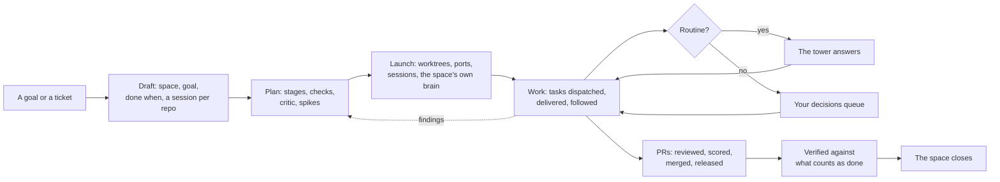
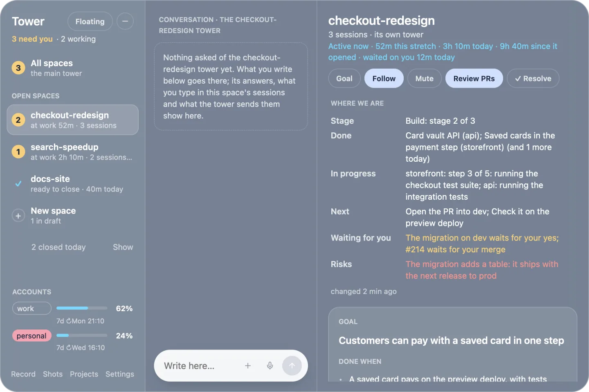

# herdr-tower

An orchestrator for the Claude Code and Codex sessions you run in
[Herdr](https://herdr.dev). You give it a goal; it turns the goal into a
plan, opens a space for it with a session per repo (each in its own git
worktree), hands out the work, follows every session on this Mac and on
every machine added with `hc machine add`, answers the routine questions
itself, verifies what comes back, and brings you only the decisions that are
yours: a merge, a migration, a choice only you can make.

<p align="center">
  
  <br><sub>Three spaces at work and one queue of what only you can decide, the heaviest first: here a PR ready to merge, with its checks, review, risk score, validation and impact.</sub>
</p>

You can drive it from the Mac panel, the phone app, the CLI or by voice; the
work is the same. (The screenshots use made-up spaces, sessions and accounts:
[`docs/screenshots/demo_state.py`](docs/screenshots/demo_state.py).)

## How it orchestrates



- **One goal, many sessions.** A space is a mission: a goal, what counts as
  done, and the sessions that get it there, one per repo, each in its own
  worktree and branch with its own dev port. Sessions in a space are
  introduced to each other and write to each other through the tower
  (`tower queue` from one to another), and every message is kept in the
  space's thread.
- **Across accounts, agents and machines.** Claude Code on any account,
  Codex, and sessions on other machines are introduced to each other with
  how to reach each one, and the tower carries what they can't send
  themselves: a `To <address>: …` line in a session's final message is
  delivered for it (a Codex sandbox that can't run `tower`), and the answer
  to a question one session asked another goes back to the asker by itself.
  A session moved to another account, or reopened in a new terminal after a
  restart, keeps its messages.
- **A brain per space.** The main brain (a Claude Code or Codex session of the
  tower's) takes your requests; each space gets a tower of its own that
  follows only that space's sessions. A daemon underneath watches every
  terminal (Herdr's events, the agents' hooks, their transcripts) and tells
  the right brain what happened: a session stopped, asked something, failed,
  started a job, opened a PR.
- **Work is delivered, then verified.** Each request becomes an **agenda**
  of tasks: who got each, when it was delivered (an instruction to a busy
  session waits in a queue until its turn ends), and whether it was
  verified, failed (twice: a decision for you) or dropped. A space's goal
  follows your requests, and a space closes itself once its goal is met.
- **You decide the 10%.** The tower answers what is routine (under your
  behaviors and the question policy) and puts the rest in one **decisions
  queue** across every space: permissions, questions, merges, failures, what
  a brain raised. Each card says who waits and for how long and recommends
  an answer; hold one with your reason, or make an answer a rule.

## Spaces and briefs

`tower launch "<goal>"` (or New space in the panel, or the phone) drafts the
space: its name, goal, what counts as done, the projects and a session per
repo. Nothing opens until you launch it. While it runs, every space keeps a
**brief**: its stage, what is done, what is in progress, what is next, what
waits for you, the risks, and how long it has been at work.

<p align="center">
  
  <br><sub>A space's brief: in progress is each session's live progress line; waiting for you links to its cards.</sub>
</p>

## Plans before work

**Plan it first** hands the draft to the tower's planner, which reads the
repos and writes the plan as a page on your claude.ai account:

- **Stages** (spike, build, release), each with what counts as done and the
  checks before and after it, and the PRs it should open, each predicted
  with its risk.
- A **critic** reads the draft first and sends its gaps back to the planner.
- **Spikes** run before the build and feed a revision.
- Once launched the plan stays **live**: what the sessions find (an
  assumption that turned out wrong, a PR that has to split) revises it,
  small changes by themselves and big ones on your word. Each session gets
  its part of the plan as a structured handoff.

<p align="center">
  
  <br><sub>A plan: the conversation with the planner, the critic's note, each stage with the checks that say it is done.</sub>
</p>

## Following the work

- **Live progress.** Every working session has a progress line, read from
  its transcript every 15 s: step N of M of its task list, the call at work
  and for how long, time in, last update ("step 3 of 5: running the checkout
  test suite · 41 min in · last update just now"). The sessions the tower
  starts keep a task list (`[sessions] todo_tools`).
- **Asking without interrupting.** **How is it going?** (`tower progress
  <session> [question]`) asks a working session a side question with Claude
  Code's own `/btw`: it answers while its turn goes on, and the tower reads
  the answer back. The brain asks the same way when you ask how something is
  going.
- **Background jobs.** A turn can end while the work goes on. The tower
  sees Claude Code's background shells and tells **jobs** (a training run,
  an eval, a deploy wait) from **servers** (a dev server, a container): a
  session with a job shows "running a job: Train the 1.2B ranker, since
  13:05, last progress just now", not done; a job that goes quiet is flagged
  once; you hear when it ends.
- **Browsers.** When a session drives a browser (Claude in Chrome, the
  built-in one, Playwright, a headless one): which, the site, since when, and
  a warning when two sessions share your Chrome.
- **After a restart.** What a restart of the Mac or of Herdr closed is
  reopened, each session resuming its own conversation (`tower reopen`).

<p align="center">
  
  <br><sub>A session: its progress line, How is it going?, the card it waits on, what it was asked and last said.</sub>
</p>

## From PR to release

Every PR a space's sessions open is followed through to production:

- A **reviewer session** reads it for critical issues and agrees with the
  PR's session before you merge.
- A **review score** says whether it needs a human review (a migration, a
  breaking change, secrets, infrastructure, auth, money…) or is low risk;
  **validation** lists the plan's checks for it with their proof; **impact**
  names who outside depends on what it changes.
- The merge card merges it, or a **chain** of PRs in order; with `tower
  automerge on` the tower merges low-risk PRs into dev itself. A PR whose
  conflicts its session can't resolve comes back to you.
- The **release track** shows where each change stands, repo by repo: open,
  on dev, on prod.

## Accounts and failover

Each session, space and brain shows the Claude account it runs on, and each
account its usage (the claude-accounts mod `cca`). A session or tower that
hits its account's limit is **moved**: resumed in its own terminal on the
next account with usage, with its conversation and what it was doing.

<p align="center">
  
  <br><sub>Accounts: usage and resets, where new sessions start, who runs where.</sub>
</p>

## Talking to it

The same tower, four ways in:

- **The Mac panel**: the full window (every space, the queue, the record,
  screenshots sessions sent, projects, settings) and a floating panel beside
  the orb.
- **The phone**: the Android app, [herdr-tower-android](https://github.com/hasangilak/herdr-tower-android),
  pairs over the local network or Tailscale and has the same queue, spaces,
  briefs, progress, merges and voice ([docs/mobile-api.md](docs/mobile-api.md);
  `tower phone enable`, then `tower phone pair`).
- **The CLI**: everything the brain does, you can (below).
- **Voice**: hold Control anywhere (or set a wake word) and talk; it answers
  out loud and in text. Whisper and Kokoro run locally, in the same binary.
  How much it tells you is yours: `tower tell decisions | results | everything`.

<p align="center">
  
  <br><sub>The orb: how it moves says what the tower is doing, its number how many decisions wait.</sub>
</p>

## Install

macOS on Apple silicon, with [Herdr](https://herdr.dev) and Rust:

```sh
brew install cmake                 # whisper.cpp builds with it
cargo build --release
./target/release/tower install     # the binary in ~/.local/bin, config, the brain's folder, the agent hooks
tower up                           # the daemon, the brain and the orb
```

`install` writes `~/.config/herder-tower/config.toml` and adds the tower's
hooks to `~/.claude/settings.json` and `~/.codex/hooks.json` beside what is
there (backed up first; `tower hooks remove` takes them out). The first
`tower up` downloads the Kokoro voice (~330 MB); the Whisper model goes to
`~/.local/share/herder-tower/models/`. `tower doctor` checks the setup.

Several Claude accounts are optional: with the claude-accounts mod (`cca`),
`tower start --account <name>` picks one, and the failover moves work between
them.

## The CLI at a glance

The brain uses the same commands you do. `tower <command> --help` says more.

| | |
|---|---|
| Spaces | `launch "<goal>"`, `plan`, `space goal/close/resolve`, `spaces`, `missions`, `brief`, `setups`, `focus`, `digest` |
| Sessions | `start`, `dispatch`, `queue`, `agents`, `sessions`, `progress`, `thread`, `introduce`, `show`, `reopen` |
| Work | `agenda`, `job-running`, `history`, `summary`, `screenshot`, `screenshots` |
| Decisions | `decisions`, `answer`, `hold`, `unhold`, `dismiss`, `questions`, `policy`, `raise`, `undo`, `acts` |
| PRs | `review`, `pr`, `automerge`, `validate`, `impact`, `releases` |
| Accounts | `accounts --usage`, `failover`, `todo-tools` |
| Run | `up`, `down`, `restart`, `status`, `doctor`, `orb`, `install`, `model` |
| Talk | `ask`, `tell`, `say`, `talk`, `hush`, `mode`, `mute`, `mac-voice` |
| Phone | `phone enable / pair / devices / network` |

## Config

`~/.config/herder-tower/config.toml` (written by `install`; `tower restart`
picks up a change). The main settings:

| Setting | What it does |
|---|---|
| `brain`, `[brains] model`, `effort` | The brains' agent (`claude` or `codex`), model and effort (`tower model`) |
| `question_policy` | `normal` (it answers routine questions), `keep-moving`, `ask-everything` |
| `[tell] level` | How much it tells you: `decisions`, `results`, `everything` |
| `[spaces]` | Worktrees per space, dev ports, when a quiet space closes |
| `[sessions] introduce`, `todo_tools` | Sessions in a space introduced to each other; a task list for the sessions it starts |
| `[queue]`, `[agenda]` | Delivering to busy sessions, re-trying failed tasks |
| `[prs] auto_merge_low_risk` | The tower merges low-risk PRs into dev itself (off) |
| `[lan]` | The phone API (off until `tower phone enable`) |
| `voice`, `mode`, `talk_key`, `wake_words`, `language` | How it speaks and hears |

## More

- [docs/reference.md](docs/reference.md): the full reference, part by part.
- [docs/planning-v2.md](docs/planning-v2.md): plans with stages, critic, spikes and revisions.
- [docs/state-machines.md](docs/state-machines.md): the state machines behind sessions, questions, queued instructions and jobs.
- [docs/questions.md](docs/questions.md): how session questions are read and answered.
- [docs/quiet-tower.md](docs/quiet-tower.md): the panel's design, every state.
- [docs/mobile-api.md](docs/mobile-api.md): the phone API.
